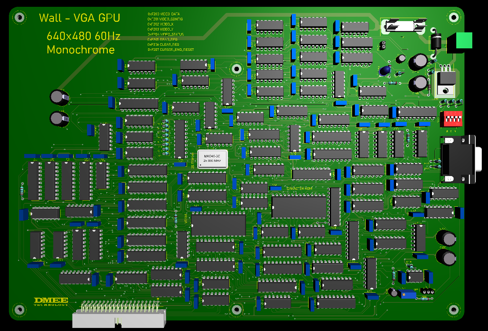
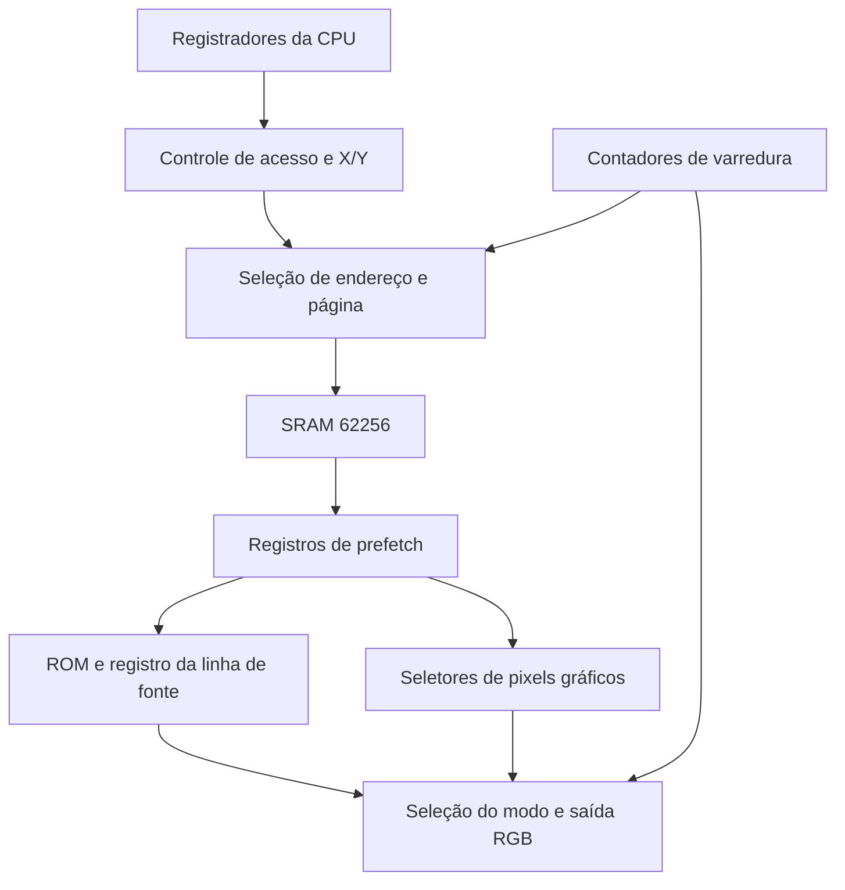

<div align="center">

# WALL-8 — Especificação da Placa de Vídeo

<p>Este é o documento de referencia da GPU , montada da mesma forma e ideia da CPU com portas logicas Porem com familia 74AC/74ACT. 
</p>

</div>

[← Voltar ao README](../../README.md) · [Referência de hardware da CPU](../wall8_CPU_Hardware.md) · [Esquema eletrônico da GPU](Hardware_GPU_Completo.pdf)



## Especificações rápidas

| Item | Especificação |
|---|---|
| Arquitetura | GPU discreta, baseada em lógica digital |
| Família lógica principal | 74AC / 74ACT / 74HC / 74HCT |
| Saída de vídeo | VGA analógico |
| Resolução de saída VGA | 640 × 480 @ 60 Hz |
| Clock de referência | Oscilador de 25,175 MHz |
| Modos de vídeo | 3 modos |
| Modo texto | 80 × 30 caracteres (fonte 8 × 8) |
| Modo gráfico 1 | 320 × 240 pixels |
| Modo gráfico 2 | 160 × 120 pixels |
| Profundidade de cor | 1 bit por pixel (monocromático) |
| VRAM | 32 KiB SRAM |
| Double buffering | Sim, alternância durante VBlank |
| Controle | Portas lógicas e registradores de hardware |
| Interface com CPU | Barramento paralelo de 8 bits |
| Cursor de texto | Implementado em hardware |
| Limpeza de tela | Comando CLEAR por hardware |
| Alimentação lógica | 5 V DC |
| Tecnologia de montagem | PTH (Through-Hole) |
| Dimensões da PCB | 300 × 207 mm |

## Temporização VGA

| Item | Especificação |
|---|---|
| Padrão de vídeo | VGA 640 × 480 @ 60 Hz |
| Clock de pixel | 25,175 MHz |
| Frequência horizontal | ≈ 31,469 kHz |
| Frequência vertical | ≈ 59,94 Hz |
| Pixels visíveis por linha | 640 |
| Front Porch horizontal | 16 pixels |
| Pulso HSYNC | 96 pixels |
| Back Porch horizontal | 48 pixels |
| Total horizontal | 800 pixels |
| Linhas visíveis | 480 |
| Front Porch vertical | 10 linhas |
| Pulso VSYNC | 2 linhas |
| Back Porch vertical | 33 linhas |
| Total vertical | 525 linhas |
| Polaridade HSYNC | Negativa |
| Polaridade VSYNC | Negativa |
| Intervalo de atualização | ≈ 16,68 ms |

## 1. Objetivo

A placa de vídeo do WALL-8 é um periférico independente responsável por gerar continuamente a imagem enviada ao monitor.

A CPU não gera os pulsos de sincronismo nem transmite cada pixel ao monitor. Ela:

- seleciona o modo e as opções de vídeo;
- envia códigos de caracteres ou bytes gráficos;
- escolhe a posição de escrita e leitura;
- consulta `BUSY` e `CURSOR_END`;
- solicita leitura, limpeza e reconhecimento de fim;
- seleciona o banco de fonte e controla as páginas do double buffer.

A própria placa mantém a imagem em uma SRAM de 32 KiB, lê essa memória durante a varredura e gera o sinal VGA.

Os três modos implementados são texto `80 × 30`, gráfico monocromático `320 × 240` e gráfico monocromático `160 × 120`. Todos usam saída física `640 × 480`, proporção `4:3`.

## 2. Resumo dos modos

| `MODE_B1:MODE_B0` | Modo | Resolução lógica | Escala para 640 × 480 | Bytes úteis por página | Passo físico entre linhas |
|---|---|---|---|---:|---:|
| `00` | Texto | 80 × 30 caracteres, fonte 8 × 8 | 1× horizontal e 2× vertical; célula 8 × 16 | 2.400 | 128 bytes |
| `01` | Gráfico monocromático | 320 × 240 pixels | 2 × 2 por pixel lógico | 9.600 | 64 bytes |
| `10` | Gráfico monocromático | 160 × 120 pixels | 4 × 4 por pixel lógico | 2.400 | 32 bytes |
| `11` | Não implementado | — | — | — | — |

O modo é um campo persistente de `VIDEO_CTRL[1:0]`. Não existe uma tabela de opcodes de modo em `$F201`.

A mesma VRAM é reutilizada pelos três modos. Mudar o modo altera sua interpretação, sem converter ou limpar automaticamente o conteúdo.

## 3. Blocos internos da placa

Há três caminhos principais: interface com a CPU, acesso compartilhado à VRAM e geração dos pixels.



O circuito mantém um byte em registros e seleciona seus bits com multiplexadores. Não há um shift register de pixels no esquema atual.


## 4. Saída física de vídeo e sincronismo VGA

A saída permanece em `640 × 480`, aproximadamente `59,94 Hz`, com oscilador próprio de `25,175 MHz`. O clock de vídeo não depende do clock da CPU.

### 4.1. Resolução lógica e física

A resolução lógica representa o conteúdo que a CPU manipula. A resolução física representa os pixels enviados ao monitor.

| Modo | Organização lógica | Área física |
|---|---|---|
| Texto | 80 × 30 células de fonte 8 × 8 | Células 8 × 16 |
| Gráfico 320 × 240 | 320 × 240 bits | Pixels ampliados 2 × 2 |
| Gráfico 160 × 120 | 160 × 120 bits | Pixels ampliados 4 × 4 |

A troca de modo não muda o total de clocks por linha ou de linhas por quadro.

### 4.2. Temporização horizontal

Uma linha tem `800` clocks de pixel. A tabela abaixo expressa a temporização nominal na fase VGA, tomando o primeiro pixel visível como posição zero:

| Região | Clocks | Posições na fase VGA nominal |
|---|---:|---|
| Área visível | 640 | 0–639 |
| Front porch | 16 | 640–655 |
| HSYNC, ativo em nível baixo | 96 | 656–751 |
| Back porch | 48 | 752–799 |
| **Total** | **800** | **0–799** |

Essas posições não devem ser usadas como equivalências diretas do contador interno `H_COUNT`. O esquema adianta leituras e registra sinais em diferentes fases: `VIDEO_ACTIVE` passa por U81:A e U94, enquanto `HSYNC_RAW` passa por U81:B, U94 e U44:A. U81:A usa `H_COUNT_4`; U81:B usa `/H_COUNT_4`.

Portanto, a fase dos endereços de prefetch, a fase dos pixels e a fase de HSYNC precisam ser consideradas juntas. A tabela nominal não é um relatório de medição.

#### Fase inferida do esquema atual

Uma análise funcional ideal das bordas, sem os atrasos reais dos CIs e após a estabilização dos latches, produz:

| Região na saída | Faixa de `H_COUNT` inferida | Clocks |
|---|---|---:|
| Área ativa registrada | 17–656 | 640 |
| Front porch | 657–673 | 17 |
| HSYNC baixo após U44:A | 674–769 | 96 |
| Back porch | 770–799 e 0–16 | 47 |

A lógica bruta de visibilidade liga na contagem 1 e desliga na 641; U81:A amostra nas bordas de subida de H_COUNT_4 e U94 registra no pixel clock seguinte. HSYNC_RAW vai a zero na 657 e volta a um na 753; U81:B amostra nas bordas de subida de /H_COUNT_4, seguido por U94 e U44:A.

Assim, o modelo lógico mantém 640 pixels ativos e pulso de 96 clocks, mas desloca um clock entre os porches em relação aos 16/48 nominais. Essa diferença deve ser confirmada em simulação com os componentes ou por medição. Não se deve apresentar o esquema como uma temporização 16/48 já comprovada na saída. O alinhamento do conteúdo de cada modo também precisa ser verificado com os pixels de borda.

### 4.3. Temporização vertical

Um quadro tem `525` linhas:

| Região | Linhas | `V_COUNT` |
|---|---:|---|
| Área visível | 480 | 0–479 |
| Front porch | 10 | 480–489 |
| VSYNC, ativo em nível baixo | 2 | 490–491 |
| Back porch | 33 | 492–524 |
| **Total** | **525** | **0–524** |

O contador vertical avança uma vez por linha. Ao terminar a linha 524, volta a zero. A lógica de U25 produz `VBLANK_START` ao entrar no intervalo vertical, na linha 480; essa borda é usada internamente para registrar a página visível.

### 4.4. Frequências resultantes

Com oscilador nominal de `25.175.000 Hz`:

```text
Período do pixel = 1 / 25.175.000 ≈ 39,722 ns
Frequência horizontal = 25.175.000 / 800 = 31.468,75 Hz
Período da linha ≈ 31,778 µs
Clocks por quadro = 800 × 525 = 420.000
Frequência vertical = 25.175.000 / 420.000 ≈ 59,9405 Hz
Período do quadro ≈ 16,6832 ms
```

Esses valores derivam do oscilador especificado e dos divisores. Tolerância do oscilador e atrasos reais pertencem à validação elétrica.

### 4.5. Área ativa e blanking

U96:A combina o pixel selecionado e o sinal registrado de área ativa. Fora da área ativa, a saída RGB fica preta, enquanto HSYNC e VSYNC continuam funcionando.

Há sinais internos de área visível e de início do blanking vertical. Eles não são bits disponíveis em `VIDEO_STATUS`. A CPU não consegue consultar HBLANK, VBLANK ou um contador de quadros pela interface atual.

Neste documento, `PX` e `PY` designam coordenadas físicas dentro da imagem ativa: `PX=0..639` e `PY=0..479`. As fórmulas de escala usam essas coordenadas, separadas da fase interna de prefetch.

### 4.6. Escala do modo gráfico 320 × 240

```text
X_lógico = PX >> 1
Y_lógico = PY >> 1
```

Cada bit representa um pixel lógico e permanece por dois clocks físicos. Um byte representa oito pixels lógicos, ou 16 pixels físicos. Cada linha lógica é repetida em duas linhas físicas.

| Pixel lógico | Colunas físicas correspondentes |
|---:|---|
| 0 | 0 e 1 |
| 1 | 2 e 3 |
| 2 | 4 e 5 |

O hardware obtém a escala selecionando os bits apropriados dos contadores, sem um divisor aritmético.

### 4.7. Escala do modo gráfico 160 × 120

```text
X_lógico = PX >> 2
Y_lógico = PY >> 2
```

Cada bit permanece por quatro clocks físicos. Um byte representa oito pixels lógicos, ou 32 pixels físicos. Cada linha lógica é repetida quatro vezes.

### 4.8. Escala do modo texto 80 × 30

```text
80 × 8 = 640 pixels horizontais
30 × 8 × 2 = 480 linhas físicas
```

Não há duplicação horizontal. Cada uma das oito linhas de um glifo é repetida duas vezes na vertical, formando uma célula física de `8 × 16`.

```text
coluna_texto = PX >> 3
linha_texto = PY >> 4
pixel_fonte_x = PX AND 7
pixel_fonte_y = (PY >> 1) AND 7
```

A VRAM fornece o código do caractere, a ROM fornece a linha de oito pixels e U88 retém esse byte para U79 selecionar os bits.

### 4.9. Contadores, prefetch e registros de saída

- U11/U12/U13 formam o contador horizontal, com 800 clocks por linha.
- U16/U17/U18 formam o contador vertical, com 525 linhas por quadro.
- U59 decodifica `H_COUNT[2:0]` em `/STEP_0` a `/STEP_7`.
- U33 captura o barramento da VRAM na fase definida por `H_COUNT_0`.
- U77 registra o pedido de prefetch; U60 carrega o byte na borda do pixel clock quando `/PREFETCH_LOAD` está ativo.
- U88 carrega a linha de fonte na borda do pixel clock quando `/STEP_7` está ativo. Seu clock é `25,175 MHz`, não `/H_COUNT_2`.
- U82 seleciona o caminho de pixel do modo; U94 registra pixels e sinais de vídeo.
- U44:A acrescenta o registro final do caminho de HSYNC.

A seleção de bits e os registros dão tempo para intercalar operações da CPU na SRAM. A temporização exata desse compartilhamento é discutida nas seções 31–34.

### 4.10. RGB, sincronismo e cor global

O framebuffer permanece com um bit por pixel. `BIT_RGB` alimenta os três canais através de U85, resistores de `470 Ω` (R8–R10) e SW1. O DIP permite habilitar manualmente R, G e B e escolher a cor global dos pixels acesos; os pixels apagados são pretos.

A quarta posição de SW1 não é um canal de cor adicional. Não há registrador de paleta, cor individual de pixel ou atributo de cor por caractere.

| Conector VGA J2 | Função no esquema |
|---|---|
| Pino 1 | R |
| Pino 2 | G |
| Pino 3 | B |
| Pino 13 | HSYNC, com resistor série de 68 Ω |
| Pino 14 | VSYNC, com resistor série de 68 Ω |

## 5. Interface com o WALL-8

A CPU seleciona a página de vídeo por `/VIDEO_SEL`. U7 decodifica somente `EXBUS[2:0]`:

| Endereço principal | Nome | Acesso | Função |
|---|---|---|---|
| `$F200` | `VIDEO_DATA` | R/W | Escrita dispara gravação; leitura retorna o último resultado capturado |
| `$F201` | `VIDEO_CTRL` | W | Configuração persistente de oito bits |
| `$F202` | `VIDEO_X` | W | Coluna de caractere ou coluna de byte |
| `$F203` | `VIDEO_Y` | W | Linha de caractere ou linha gráfica |
| `$F204` | `VIDEO_STATUS` | R | `BUSY` no bit 0 e `CURSOR_END` no bit 4 |
| `$F205` | `READ_REQ` | W | Solicita leitura de VRAM em X/Y |
| `$F206` | `CLEAR_REQ` | W | Inicia preenchimento da área útil com zero |
| `$F207` | `CURSOR_END_RESET` | W | Limpa apenas a flag de fim |

O byte enviado a `$F205`, `$F206` e `$F207` é ignorado. A ação ocorre pela escrita no endereço, não pelo valor do dado.

A decodificação da CPU também seleciona vídeo em `$FAxx`; assim, `$FA00..$FA07` espelham `$F200..$F207`. Como U7 ignora A3–A7, os offsets se repetem a cada oito bytes dentro das páginas selecionadas. O software deve usar os oito endereços principais para manter o código claro.

Não há janela de VRAM diretamente mapeada no espaço de memória da CPU. `VIDEO_CTRL`, X e Y não têm leitura de retorno. Ler endereços somente de escrita não fornece seus valores.

### 5.1. Conector da GPU

J1 da GPU corresponde ao conector J4, 2×20, da CPU:

| Pino | Sinal | Pino | Sinal |
|---:|---|---:|---|
| 1 | GND | 2 | +5 V |
| 3 | GND | 4 | +5 V |
| 5 | `EXBUS0` | 6 | `DBUS0` |
| 7 | `EXBUS1` | 8 | `DBUS1` |
| 9 | `EXBUS2` | 10 | `DBUS2` |
| 11 | `EXBUS3` | 12 | `DBUS3` |
| 13 | `EXBUS4` | 14 | `DBUS4` |
| 15 | `EXBUS5` | 16 | `DBUS5` |
| 17 | `EXBUS6` | 18 | `DBUS6` |
| 19 | `EXBUS7` | 20 | `DBUS7` |
| 21 | `EXBUS8` | 22 | NC |
| 23 | `EXBUS9` | 24 | `/VIDEO_SEL` |
| 25 | `EXBUS10` | 26 | `/MEMORY_OE` |
| 27 | `EXBUS11` | 28 | `/MEMORY_WE` |
| 29 | `EXBUS12` | 30 | `/VIDEO_DETECT` |
| 31 | `EXBUS13` | 32 | NC |
| 33 | `EXBUS14` | 34 | `CLOCK_PeRA` |
| 35 | `EXBUS15` | 36 | NC |
| 37 | GND | 38 | +5 V |
| 39 | GND | 40 | +5 V |

Embora todos os bits de endereço cheguem ao conector, a GPU usa os três inferiores para selecionar os registradores; a CPU fornece a seleção da página. U2 e U9 só devem dirigir DBUS durante suas leituras selecionadas.

### 5.2. Regra de acesso

A GPU aceita uma operação de VRAM por vez. Antes de modificar CTRL, X/Y ou DATA ou escrever em um endereço de solicitação/reconhecimento, espere `BUSY=0`. Durante uma operação, a CPU pode consultar STATUS ou realizar trabalho que não altere a interface da GPU.

A inicialização de CTRL é necessária porque U5 não possui reset que defina o byte de configuração. A sequência de partida está na seção 40.

## 6. Detecção da placa

O registrador geral de status do WALL-8 informa a presença física:

```text
$F300 bit 5 = /VIDEO_DETECT
0 = placa presente
1 = placa ausente
```

No conector da GPU, o pino 30 é ligado ao GND. O pull-up na CPU indica ausência quando o módulo não está conectado.

```asm
LDA $F300
TEST A, #$20
JNZ SEM_VIDEO
```

Esse sinal informa presença, não conclusão de boot ou funcionamento do VGA.

---

# Parte I — Registradores

## 7. `VIDEO_DATA` — `$F200`

### 7.1. Escrita

Uma escrita em `VIDEO_DATA` retém o byte em U1 e solicita sua gravação na posição atual. U37:A registra a operação pendente; `BUSY` permanece ativo até sua conclusão.

1. Espere `BUSY=0`.
2. Configure X/Y, se necessário.
3. Escreva o byte em DATA.
4. Mantenha a interface estável enquanto `BUSY=1`.
5. Após a gravação, X/Y avançam se `AUTO_INCREMENT=1`.

Texto e gráficos usam o mesmo gatilho. A GPU não interpreta os bytes `$08`, `$0A` ou `$0D` como controles de terminal: todos são dados.

| Modo | Significado do byte |
|---|---|
| Texto | Código de glifo, 0–255, no banco de fonte selecionado |
| Gráfico | Oito pixels lógicos horizontais |

### 7.2. Ordem dos bits

Nos modos gráficos e nas linhas da fonte, D0 é o pixel mais à esquerda e D7 é o mais à direita.

| Byte | Pixels da esquerda para a direita, D0 → D7 |
|---|---|
| `$01` | `10000000` |
| `$80` | `00000001` |
| `$AA` | `01010101` |
| `$55` | `10101010` |
| `$FF` | `11111111` |
| `$00` | `00000000` |

Essas sequências representam a ordem visual D0→D7, não a escrita binária convencional D7→D0.

### 7.3. Leitura

Ler DATA não inicia um acesso à SRAM. A leitura da CPU retorna o resultado mantido em U48:

```asm
CALL VIDEO_WAIT
STI VIDEO_X, #$01
STI VIDEO_Y, #$14
STI READ_REQ, #$00
CALL VIDEO_WAIT
LDA VIDEO_DATA
```

U48 captura o resultado durante a operação solicitada, na borda de subida de `H_COUNT_2`, com `/READ` ativo. A CPU deve esperar BUSY baixar antes de usar o resultado.

Leituras não incrementam X/Y, independentemente de `AUTO_INCREMENT`. Antes da primeira leitura concluída, o resultado não deve ser usado como dado válido. DATA não é uma leitura de retorno do último byte escrito pela CPU.

## 8. `VIDEO_CTRL` — `$F201` e registradores de ação

### 8.1. Configuração persistente

| Bit | Nome | Função |
|---:|---|---|
| 0 | `MODE_B0` | Bit inferior do modo |
| 1 | `MODE_B1` | Bit superior do modo |
| 2 | `DOUBLE_BUFFER_EN` | 0: página 0 para todos; 1: varredura e CPU em páginas opostas |
| 3 | `DISPLAY_PAGE` | Página solicitada para a varredura; registrada em `VBLANK_START` |
| 4 | `CURSOR_VISIBLE` | Habilita o cursor piscante no caminho de texto |
| 5 | `AUTO_INCREMENT` | Habilita avanço de X/Y após uma escrita normal |
| 6 | `Char_Bank_14` | Bit inferior do banco da ROM de fonte |
| 7 | `Char_Bank_15` | Bit superior do banco da ROM de fonte |

Cada escrita substitui os oito bits. U5 não tem valor de reset garantido, nem leitura de retorno. Mantenha uma cópia do byte em RAM e use máscaras para alterar campos.

Os exemplos reservam `VIDEO_CTRL_SHADOW=$02AE`. Esse endereço é uma escolha do exemplo e precisa respeitar a alocação de RAM da BIOS ou do programa.

| Configuração completa de exemplo | Byte |
|---|---|
| Texto, banco 0, cursor habilitado, auto incremento, página única | `$30` |
| Gráfico 320 × 240, auto incremento, página única | `$21` |
| Gráfico 160 × 120, auto incremento, página única | `$22` |

Esses bytes são configurações completas, não opcodes. Por exemplo, escrever `$20` em CTRL habilita auto incremento no modo texto; isso não solicita leitura.

#### Alterar somente o modo

```asm
CALL VIDEO_WAIT
LDA VIDEO_CTRL_SHADOW
AND A, #$FC
OR A, #$01               ; gráfico 320 × 240
STA VIDEO_CTRL_SHADOW
STA VIDEO_CTRL
```

Use `$00`, `$01` ou `$02` no campo de modo. A troca não reinicializa X/Y, não limpa CURSOR_END e não limpa a VRAM. Depois dela, configure posições válidas ou execute CLEAR.

#### Selecionar o banco de fonte

```asm
CALL VIDEO_WAIT
LDA VIDEO_CTRL_SHADOW
AND A, #$3F
OR A, #$80               ; banco 2, bits 7:6 = 10
STA VIDEO_CTRL_SHADOW
STA VIDEO_CTRL
```

O banco muda a interpretação dos códigos de texto já existentes na VRAM. Não é uma operação de carregamento de fonte.

### 8.2. `READ_REQ` — `$F205`

Qualquer escrita solicita uma leitura do byte em X/Y na página acessível à CPU. Espere BUSY antes e depois, então leia DATA. O byte enviado é ignorado e X/Y não avançam.

### 8.3. `CLEAR_REQ` — `$F206`

Qualquer escrita inicia CLEAR. A lógica:

1. reinicializa X/Y para `(0,0)` e limpa CURSOR_END;
2. grava `0x00` em cada posição válida do modo atual;
3. avança X/Y durante CLEAR mesmo com `AUTO_INCREMENT=0`;
4. ao terminar, retorna X/Y a `(0,0)`, marca CURSOR_END e libera BUSY.

O preenchimento vem de U76, cujas entradas de dados estão em GND. O valor enviado a CLEAR_REQ não escolhe a cor nem o código de preenchimento.

```asm
CALL VIDEO_WAIT
STI CLEAR_REQ, #$00
CALL VIDEO_WAIT
STI CURSOR_END_RESET, #$00
```

Em texto, CLEAR grava o código de glifo zero, não `$20`. Para obter uma tela sem caracteres, o glifo normal `$00` precisa estar vazio em cada banco de fonte usado. O cursor pode aparecer sobre uma célula de código zero pela variante da ROM.

CLEAR percorre a área útil do modo, respeitando o passo entre linhas. Não apaga todos os 16 KiB da página, os espaços entre linhas nem a outra página. Não altera CTRL nem fornece um novo resultado de leitura em DATA.

### 8.4. `CURSOR_END_RESET` — `$F207`

Qualquer escrita limpa a flag CURSOR_END sem alterar X/Y. Espere BUSY antes de reconhecer a flag.

```asm
CALL VIDEO_WAIT
STI CURSOR_END_RESET, #$00
```

Escrever X/Y ou mudar o modo não substitui esse reconhecimento. Início de CLEAR e reset geral também limpam a flag.

### 8.5. Double buffer e mudança de página

A SRAM possui duas páginas de 16 KiB:

| Página | Faixa física |
|---:|---|
| 0 | `$0000..$3FFF` |
| 1 | `$4000..$7FFF` |

| `DOUBLE_BUFFER_EN` | Varredura | READ, WRITE e CLEAR da CPU |
|---:|---|---|
| 0 | Página 0 | Página 0 |
| 1 | `FRONT_PAGE` | `BACK_PAGE`, complemento de FRONT_PAGE |

U31:B registra `DISPLAY_PAGE` na borda de subida de `VBLANK_START`. A saída Q seleciona FRONT_PAGE; sua complementar seleciona BACK_PAGE através de U87. O bit 3 de CTRL é o pedido, não uma confirmação de página já exibida.

Procedimento de troca:

1. Aguarde a conclusão de todas as escritas na página de trás.
2. Atualize `DISPLAY_PAGE`, preservando os demais bits de CTRL.
3. Aguarde a borda de VBLANK que efetiva a troca.
4. Só depois reutilize a nova página de trás.

```asm
CALL VIDEO_WAIT
LDA VIDEO_CTRL_SHADOW
XOR A, #$08              ; solicita a outra página
STA VIDEO_CTRL_SHADOW
STA VIDEO_CTRL
```

Esse exemplo pressupõe double buffer já habilitado e o pedido anterior já efetivado. A CPU não lê FRONT_PAGE, VBLANK ou um reconhecimento de troca; BUSY acompanha operações de VRAM e não confirma o page flip.

Com a interface atual, o software pode esperar um intervalo real maior que um quadro desde a escrita em CTRL, por exemplo `18 ms`, antes de reutilizar a página de trás. Uma rotina de atraso precisa garantir esse tempo em todas as frequências de CPU usadas. Não inicie uma leitura, escrita ou CLEAR atravessando uma troca ainda pendente: a seleção da página é compartilhada e muda na borda de VBLANK.

Na ativação inicial, escolha DISPLAY_PAGE, aguarde sua efetivação e só então habilite o acesso às páginas opostas. Prepare ou limpe o conteúdo antes de exibi-lo. Desabilitar double buffer força imediatamente o acesso à página 0; faça isso com BUSY livre e considere o efeito visual.

## 9. `VIDEO_X` — `$F202`

X é um par de contadores carregáveis de oito bits. Sua escrita configura a posição horizontal; não grava VRAM e não fornece leitura de retorno.

| Modo | X válido | Unidade |
|---|---|---|
| Texto | 0–79 | Coluna de caractere |
| Gráfico 320 × 240 | 0–39 | Coluna de byte, oito pixels |
| Gráfico 160 × 120 | 0–19 | Coluna de byte, oito pixels |

Nos modos gráficos:

```text
X_byte = X_pixel >> 3
primeiro pixel do byte = X_byte × 8
último pixel do byte = X_byte × 8 + 7
```

Exemplo: `VIDEO_X=10` indica pixels lógicos 80–87. A escala para a saída física depende do modo.

Use somente valores válidos. A interface não implementa clipping nem validação geral de coordenadas enviadas pela CPU. Escrever X não limpa CURSOR_END.

## 10. `VIDEO_Y` — `$F203`

Y também é um par de contadores carregáveis de oito bits, somente de escrita para a CPU.

| Modo | Y válido | Unidade |
|---|---|---|
| Texto | 0–29 | Linha de caractere, 16 linhas físicas |
| Gráfico 320 × 240 | 0–239 | Linha de pixels lógicos, duas linhas físicas |
| Gráfico 160 × 120 | 0–119 | Linha de pixels lógicos, quatro linhas físicas |

Escrever Y configura a posição, sem alterar X nem limpar CURSOR_END. A CPU deve manter suas próprias coordenadas em RAM quando precisar conhecê-las depois de escritas ou de uma sequência de auto incremento.

## 11. `VIDEO_STATUS` — `$F204`

### 11.1. Bits disponíveis

| Bit | Nome | Significado |
|---:|---|---|
| 0 | `BUSY` | Há escrita, leitura ou CLEAR pendente/em execução |
| 1–3 | Zero | Ligados a GND no buffer de status |
| 4 | `CURSOR_END` | O avanço da posição chegou ao fim da área útil |
| 5–7 | Zero | Ligados a GND no buffer de status |

Não há READ_READY, HBLANK, VBLANK, FRAME ou confirmação de página no status.

### 11.2. BUSY

U49:C/D combinam `W_BUSY`, `R_BUSY` e `C_BUSY`. BUSY indica que a interface está ocupada por uma operação de VRAM, não que a varredura esteja parada.

```asm
VIDEO_WAIT:
    LDA VIDEO_STATUS
    TEST A, #$01
    JNZ VIDEO_WAIT
    RET
```

A rotina altera A e as flags. Se A contém o dado a escrever, preserve-o antes do polling, como em `VIDEO_WRITE_A` na seção 39.

### 11.3. CURSOR_END

Com auto incremento habilitado, a escrita no último byte/célula válido faz X/Y retornar a `(0,0)` e marca a flag. Não há retenção da posição na última célula nem bloqueio automático de escritas seguintes.

| Evento | Efeito sobre CURSOR_END |
|---|---|
| Final de transferência com avanço até o limite vertical | Marca 1 |
| Final de CLEAR | Marca 1 |
| Escrita em `$F207` | Limpa para 0 |
| Início de CLEAR | Limpa para 0 |
| Reset geral | Limpa para 0 |
| Escrita em X/Y | Não limpa |
| Mudança de modo | Não limpa |
| Leitura de STATUS | Não limpa |

Se a CPU continuar escrevendo depois do fim, sobrescreverá a imagem a partir de `(0,0)`. O programa deve controlar a quantidade de bytes ou tratar CURSOR_END.

Teste depois de esperar BUSY, para observar a posição e a flag após a conclusão da operação:

```asm
CALL VIDEO_WAIT
LDA VIDEO_STATUS
TEST A, #$10
JNZ FIM_DA_AREA
```

Com `AUTO_INCREMENT=0`, uma escrita normal não avança a posição e não cria uma indicação de fim por estar na última célula. CLEAR tem seu próprio avanço obrigatório.

---

# Parte II — Modo texto

## 12. Modo texto 80 × 30

A VRAM guarda um código de oito bits por célula. O gerador de texto consulta esse código na ROM de fonte, no banco indicado por CTRL[7:6].

| Propriedade | Valor |
|---|---|
| Células | 80 × 30 |
| Códigos por banco | 256 |
| Glifo armazenado | 8 × 8 bits |
| Célula física | 8 × 16 pixels |
| Dados úteis | 2.400 bytes por página |
| Passo físico da VRAM | 128 bytes por linha |

A GPU não impõe uma codificação textual. ASCII, acentos e símbolos dependem da imagem programada na ROM e das convenções da BIOS.

## 13. Organização da VRAM no modo texto

O endereço físico é formado por concatenação de bits:

```text
ENDEREÇO = (página << 14) | (Y << 7) | X
```

Para coordenadas válidas, isso equivale a `base_da_página + Y × 128 + X`, não a `Y × 80 + X`.

| Linha, página 0 | Primeiro byte | Último byte útil | Espaço até a próxima linha |
|---:|---|---|---:|
| 0 | `$0000` | `$004F` | 48 bytes |
| 1 | `$0080` | `$00CF` | 48 bytes |
| 2 | `$0100` | `$014F` | 48 bytes |
| 29 | `$0E80` | `$0ECF` | 48 bytes |

Na página 1, some `$4000` aos endereços. Os endereços da tabela pertencem à SRAM interna da GPU, não ao mapa da CPU.

Um buffer de texto na RAM da CPU pode ser compactado com índice `Y × 80 + X`. O auto incremento da GPU percorre as 80 células válidas por linha e pula os espaços físicos. Assim, 2.400 escritas sequenciais transmitem uma tela compactada inteira.

## 14. ROM de caracteres

U78 é uma EPROM `27C512`, de 64 KiB. Há quatro bancos selecionáveis e duas variantes por glifo: normal e cursor.

### 14.1. Formação do endereço

| Bits da ROM | Origem |
|---|---|
| A0–A7 | Código de caractere mantido em VRAM_LATCH |
| A8–A10 | Linha da fonte, `V_COUNT_1..3` |
| A11 | `BIT_CURSOR` |
| A12–A13 | GND |
| A14 | `Char_Bank_14`, CTRL bit 6 |
| A15 | `Char_Bank_15`, CTRL bit 7 |

```text
ENDEREÇO_ROM = (banco << 14) | (variante_cursor << 11) | (linha_fonte << 8) | código
banco = 0..3
variante_cursor = 0 ou 1
linha_fonte = 0..7
código = 0..255
```

| Banco | Variante normal | Variante de cursor |
|---:|---|---|
| 0 | `$0000..$07FF` | `$0800..$0FFF` |
| 1 | `$4000..$47FF` | `$4800..$4FFF` |
| 2 | `$8000..$87FF` | `$8800..$8FFF` |
| 3 | `$C000..$C7FF` | `$C800..$CFFF` |

A12 e A13 fixos tornam inacessíveis 12 KiB de cada intervalo de banco de 16 KiB. Há 16 KiB de conteúdo alcançável no conjunto da EPROM: quatro bancos × duas variantes × 2.048 bytes.

### 14.2. Organização do arquivo de ROM

Um glifo contém oito bytes conceitualmente, mas esses bytes não são consecutivos na EPROM. Para cada linha da fonte, a ROM armazena os 256 códigos; só depois vem a próxima linha.

Exemplo para o código `$41`, banco 0, variante normal:

| Linha da fonte | Endereço |
|---:|---|
| 0 | `$0041` |
| 1 | `$0141` |
| 2 | `$0241` |
| 3 | `$0341` |
| 4 | `$0441` |
| 5 | `$0541` |
| 6 | `$0641` |
| 7 | `$0741` |

O gerador do arquivo da EPROM precisa distribuir as linhas nesses endereços. Um arquivo com oito bytes contíguos por caractere produzirá fonte incorreta sem essa reorganização.

### 14.3. Ordem dos pixels e cursor

D0 é o pixel da esquerda em cada linha. As formas normais e as formas com cursor são programadas na ROM. O hardware não inverte automaticamente o glifo nem desenha por si um sublinhado: ele muda A11.

Para cursor em bloco invertido, grave linhas invertidas na variante 1. Para sublinhado, grave a forma desejada nessa variante. O mesmo método permite conservar o desenho normal nas linhas que não participam do cursor.

O glifo normal `$00` deve estar vazio nos bancos em que CLEAR deve produzir tela vazia. A variante de cursor desse código pode mostrar o cursor sobre a célula apagada.

## 15. Geração de um caractere

Para cada célula, a varredura lê seu código da VRAM, consulta a linha apropriada da fonte, retém o byte em U88 e seleciona seus bits com U79.

Para um pixel físico da área ativa:

```text
coluna_texto = PX >> 3
linha_texto = PY >> 4
pixel_fonte_x = PX AND 7
pixel_fonte_y = (PY >> 1) AND 7
```

Cada linha da fonte é exibida duas vezes. A leitura antecipada e os registros alinham os dados ao caminho de saída; as fórmulas acima descrevem a imagem lógica, sem substituir a análise de fase dos sinais internos.

## 16. Escrita sequencial de caracteres

Com `AUTO_INCREMENT=1`, cada escrita concluída avança a posição:

```text
Se X < 79: X = X + 1
Se X = 79 e Y < 29: X = 0; Y = Y + 1
Se X = 79 e Y = 29: X = 0; Y = 0; CURSOR_END = 1
```

Com `AUTO_INCREMENT=0`, as escritas normais repetem a posição atual. A CPU pode usá-lo para modificar uma célula sem mover o cursor.

Uma tela completa exige 2.400 escritas. Não é necessário transmitir os pixels da fonte nem preencher os espaços físicos da VRAM.

```asm
LDA #$57                  ; W
CALL VIDEO_WRITE_A
LDA #$41                  ; A
CALL VIDEO_WRITE_A
LDA #$4C                  ; L
CALL VIDEO_WRITE_A
LDA #$4C                  ; L
CALL VIDEO_WRITE_A
LDA #$2D                  ; -
CALL VIDEO_WRITE_A
LDA #$38                  ; 8
CALL VIDEO_WRITE_A
```

`VIDEO_WRITE_A` espera a operação anterior e retorna após disparar a nova. Espere novamente antes de mudar CTRL/X/Y ou de considerar o último byte concluído.

Ao chegar ao fim, o programa deve fazer scroll, terminar a transferência ou preparar outra tela. A GPU não conserva automaticamente a última posição nem implementa scroll.

## 17. Controles de terminal

Os controles de terminal são responsabilidade do software. A GPU grava qualquer valor de DATA como código de glifo, inclusive `$08`, `$0A` e `$0D`.

Uma BIOS pode adotar estas convenções:

| Código | Interpretação possível na BIOS | Trabalho do software |
|---|---|---|
| `$08` | Backspace | Calcular célula anterior, apagar e reposicionar X/Y |
| `$0A` | Line Feed | Avançar linha, conforme a convenção do terminal |
| `$0D` | Carriage Return | Reposicionar a coluna, conforme a convenção do terminal |
| Outros códigos | Caractere | Enviar o código à GPU |

Tratar CR e LF como uma ou duas ações, aceitar CRLF e manter um histórico são decisões da BIOS. Não há esse processamento no hardware, nem uma prova do comportamento da BIOS nos arquivos de esquema.

Uma nova linha pode ser feita pelo software com `VIDEO_WAIT`, escrita de X=0 e atualização explícita de Y. Como X/Y não têm leitura de retorno, o terminal deve acompanhar suas coordenadas em RAM.

## 18. Cursor

### 18.1. Cursor visível de texto

`CURSOR_VISIBLE`, bit 4 de CTRL, habilita o cursor piscante. Ele usa a mesma posição X/Y da interface de dados; não existe um segundo par de coordenadas de cursor.

```asm
; Ocultar preservando os demais campos.
CALL VIDEO_WAIT
LDA VIDEO_CTRL_SHADOW
AND A, #$EF
STA VIDEO_CTRL_SHADOW
STA VIDEO_CTRL

; Habilitar preservando os demais campos.
CALL VIDEO_WAIT
LDA VIDEO_CTRL_SHADOW
OR A, #$10
STA VIDEO_CTRL_SHADOW
STA VIDEO_CTRL
```

U89/U90 comparam a célula da varredura com X/Y. U100:A combina as igualdades. U93:A registra a comparação em `H_COUNT_2`; U93:B faz o alinhamento seguinte em `BYTE_CLK`. U19:B combina o resultado e CURSOR_VISIBLE para formar BIT_CURSOR, ligado a A11 da ROM.

A aparência depende da variante de cursor gravada na EPROM. O cursor de texto não aparece nos caminhos gráficos. X/Y continuam sendo posições de acesso à VRAM em qualquer modo.

### 18.2. Piscar por 555

O piscar é gerado por U45, um 555 em astável, e não por um divisor do clock VGA. Sua saída participa do reset dos registros U93 junto com RESET_GERAL.

| Elemento | Valor no esquema |
|---|---|
| R20 | 1 kΩ |
| R21 | 22 kΩ |
| RV1 | 100 kΩ ajustável |
| C98 | 10 µF |
| C99, desacoplamento do pino de controle | 10 nF |

Com `RB = 22 kΩ + resistência ajustada de RV1`:

```text
t_alto ≈ 0,693 × (1 kΩ + RB) × 10 µF
t_baixo ≈ 0,693 × RB × 10 µF
```

Um ajuste de aproximadamente 50 kΩ em RV1 resulta em período próximo de um segundo, cerca de 0,51 s alto e 0,50 s baixo. Os valores são nominais e variam com tolerâncias e ajuste.

J3 liga o pino RESET do 555: pino 3 é +5 V, pino 2 é RESET e pino 1 é GND. Para operação normal, use o jumper 2–3. A ligação 1–2 mantém o oscilador em reset. A habilitação visual pela CPU continua sendo o bit 4 de CTRL.

### 18.3. Posição automática nos modos gráficos

O termo cursor de escrita também pode designar X/Y, sem uma marca visual na imagem. Com auto incremento habilitado, ele avança em unidades de byte, pula para a linha seguinte e volta a `(0,0)` no fim, marcando CURSOR_END. Leituras não o movem.

---

# Parte III — Gráfico 320 × 240

## 19. Seleção do modo

Para mudar somente o campo de modo:

```asm
CALL VIDEO_WAIT
LDA VIDEO_CTRL_SHADOW
AND A, #$FC
OR A, #$01
STA VIDEO_CTRL_SHADOW
STA VIDEO_CTRL
```

O modo possui `320 × 240` pixels lógicos, um bit por pixel, oito pixels por byte e escala física 2× nos dois eixos. X válido é 0–39 e Y válido é 0–239.

Mudar o modo não faz CLEAR nem reposiciona X/Y. A inicialização completa em página única está na seção 42.

## 20. Organização da VRAM em 320 × 240

```text
ENDEREÇO = (página << 14) | (Y << 6) | X_byte
```

O passo físico é 64 bytes por linha, dos quais 40 são úteis. Os 24 restantes não são parte do framebuffer visível.

| Linha, página 0 | Primeiro byte | Último byte útil |
|---:|---|---|
| 0 | `$0000` | `$0027` |
| 1 | `$0040` | `$0067` |
| 2 | `$0080` | `$00A7` |
| 239 | `$3BC0` | `$3BE7` |

Na página 1, some `$4000`. O último byte útil dessa página é `$7BE7`.

Há `40 × 240 = 9.600` bytes úteis por página. A região formada por 240 passos de linha ocupa `64 × 240 = 15.360` bytes, incluindo os espaços entre linhas, dentro de uma página de 16 KiB.

Um framebuffer compacto na RAM da CPU usa índice `Y × 40 + X_byte`; esse índice não é o endereço físico da SRAM. O auto incremento da GPU permite transmitir seus 9.600 bytes em sequência, pulando os espaços físicos.

## 21. Escala 2×

```text
X_lógico = PX >> 1
Y_lógico = PY >> 1
```

Um pixel lógico é mostrado como duas colunas e duas linhas físicas. Cada byte gráfico é reutilizado durante 16 clocks de pixel e a mesma linha lógica é exibida em duas linhas físicas.

## 22. Escrita de bytes gráficos

Um byte controla oito pixels lógicos consecutivos, da esquerda para a direita em ordem D0→D7.

```asm
CALL VIDEO_WAIT
STI VIDEO_X, #$00
STI VIDEO_Y, #$00
LDA #$AA
CALL VIDEO_WRITE_A
LDA #$55
CALL VIDEO_WRITE_A
```

Com auto incremento habilitado, esses bytes ocupam X=0 e X=1. O padrão visual é `01010101 10101010`, em ordem D0→D7, com cada bit ampliado duas vezes na horizontal.

Com auto incremento desligado, o segundo byte substitui o primeiro na mesma posição. O chamador deve definir a opção apropriada antes da transferência.

## 23. Incremento automático em 320 × 240

Com `AUTO_INCREMENT=1`:

```text
Se X < 39: X = X + 1
Se X = 39 e Y < 239: X = 0; Y = Y + 1
Se X = 39 e Y = 239: X = 0; Y = 0; CURSOR_END = 1
```

Depois de 9.600 escritas a partir de `(0,0)`, a posição retorna ao início. A flag não impede novas escritas. Para transmitir outra imagem, reconheça CURSOR_END e controle o número de bytes enviados.

---

# Parte IV — Gráfico 160 × 120

## 24. Seleção do modo

```asm
CALL VIDEO_WAIT
LDA VIDEO_CTRL_SHADOW
AND A, #$FC
OR A, #$02
STA VIDEO_CTRL_SHADOW
STA VIDEO_CTRL
```

Esse modo possui `160 × 120` pixels lógicos, um bit por pixel, oito pixels por byte e escala física 4× nos dois eixos. X válido é 0–19 e Y válido é 0–119.

Mudar o modo não faz CLEAR nem reposiciona X/Y. A inicialização completa em página única está na seção 43.

## 25. Organização da VRAM em 160 × 120

```text
ENDEREÇO = (página << 14) | (Y << 5) | X_byte
```

O passo físico é 32 bytes por linha, dos quais 20 são úteis e 12 ficam fora da área visível.

| Linha, página 0 | Primeiro byte | Último byte útil |
|---:|---|---|
| 0 | `$0000` | `$0013` |
| 1 | `$0020` | `$0033` |
| 2 | `$0040` | `$0053` |
| 119 | `$0EE0` | `$0EF3` |

Na página 1, some `$4000`. O último byte útil é `$4EF3`.

Há `20 × 120 = 2.400` bytes úteis. A região de 120 passos de linha ocupa `32 × 120 = 3.840` bytes, incluindo os espaços. Um buffer compacto da CPU pode usar `Y × 20 + X_byte` e ser enviado por 2.400 escritas com auto incremento.

## 26. Escala 4×

```text
X_lógico = PX >> 2
Y_lógico = PY >> 2
```

Um pixel lógico é mostrado como quatro colunas e quatro linhas físicas. Cada byte representa 32 clocks de pixel na horizontal.

Uma tela inteira exige quatro vezes menos dados e escritas que no modo 320 × 240: 2.400 em vez de 9.600 bytes. Isso reduz o trabalho da CPU, sem alterar a frequência do VGA.

## 27. Incremento automático em 160 × 120

Com `AUTO_INCREMENT=1`:

```text
Se X < 19: X = X + 1
Se X = 19 e Y < 119: X = 0; Y = Y + 1
Se X = 19 e Y = 119: X = 0; Y = 0; CURSOR_END = 1
```

Depois de 2.400 escritas a partir de `(0,0)`, a posição retorna ao início. Escritas seguintes sobrescrevem o começo da imagem se o programa não tratar a flag ou controlar a quantidade transmitida.

---

# Parte V — Operações gráficas

## 28. Localização e alteração de um pixel

Para um pixel lógico `(X_pixel,Y_pixel)` em um dos modos gráficos:

```text
X_byte = X_pixel >> 3
bit = X_pixel AND 7
máscara = $01 << bit
VIDEO_Y = Y_pixel
```

D0 é o pixel da esquerda. Portanto, a máscara parte de `$01` e é deslocada para a esquerda.

Exemplo para `(13,20)`:

```text
X_byte = 1
bit = 5
máscara para acender = $20
máscara para apagar = $DF
```

Uma alteração individual é uma operação de leitura, modificação e escrita. Este exemplo desabilita auto incremento, preservando os demais campos; pressupõe modo gráfico já selecionado e nenhuma troca de página pendente:

```asm
CALL VIDEO_WAIT
LDA VIDEO_CTRL_SHADOW
AND A, #$DF               ; AUTO_INCREMENT = 0
STA VIDEO_CTRL_SHADOW
STA VIDEO_CTRL

STI VIDEO_X, #$01
STI VIDEO_Y, #$14
CALL VIDEO_READ_A
OR A, #$20                ; acende pixel (13,20)
CALL VIDEO_WRITE_A
CALL VIDEO_WAIT
```

Para apagar o mesmo pixel:

```asm
CALL VIDEO_WAIT
STI VIDEO_X, #$01
STI VIDEO_Y, #$14
CALL VIDEO_READ_A
AND A, #$DF
CALL VIDEO_WRITE_A
CALL VIDEO_WAIT
```

Esses trechos deixam auto incremento desligado. Se o chamador precisar restaurar a configuração anterior, deve guardar o byte de CTRL antes da alteração e restaurá-lo depois de esperar a escrita terminar.

READ não move X/Y. Se auto incremento estiver habilitado, somente a escrita final avança a posição. O procedimento e a máscara são os mesmos nos dois modos gráficos; seus limites de coordenadas são diferentes.

## 29. Sprites alinhados a bytes

Um sprite monocromático de `8 × 8` ocupa oito bytes em um arquivo ou buffer compacto:

```asm
SPRITE_NAVE:
    #d8 $18
    #d8 $3C
    #d8 $7E
    #d8 $DB
    #d8 $FF
    #d8 $24
    #d8 $24
    #d8 $66
```

Cada byte corresponde a uma linha do sprite; ele deve ser escrito em X_byte e no Y correspondente. As linhas da imagem na SRAM não são contíguas: usam passo físico 64 ou 32, conforme o modo. Reposicione X/Y antes de cada linha do sprite, esperando BUSY.

Sprites alinhados a oito pixels são simples porque uma linha de oito pixels corresponde a uma escrita. Para sprites não alinhados, o software divide e combina bits de dois bytes da VRAM.

Não existe motor de sprites na GPU. Sobreposição, transparência, preservação do fundo e colisões são tarefas do software.

## 30. Retângulos e linhas alinhadas

Uma linha horizontal de 32 pixels lógicos pode ser feita com quatro bytes `$FF`, com auto incremento habilitado e espaço suficiente na linha:

```asm
CALL VIDEO_WAIT
LDA VIDEO_CTRL_SHADOW
OR A, #$20
STA VIDEO_CTRL_SHADOW
STA VIDEO_CTRL

STI VIDEO_X, #$0A
STI VIDEO_Y, #$32
LDA #$FF
CALL VIDEO_WRITE_A
LDA #$FF
CALL VIDEO_WRITE_A
LDA #$FF
CALL VIDEO_WRITE_A
LDA #$FF
CALL VIDEO_WRITE_A
CALL VIDEO_WAIT
```

O exemplo é válido nos dois modos gráficos: bytes X=10..13 e linha Y=50. Cada byte representa oito pixels lógicos; a escala física depende do modo.

Para um retângulo, reposicione X/Y e repita o preenchimento em cada linha. Linhas, retângulos, clipping e composição são implementados pela CPU, não por comandos de desenho da GPU.

---

# Parte VI — Compartilhamento e arbitragem da VRAM

## 31. Por que CPU e varredura compartilham o acesso

A 62256 é uma SRAM de porta única. Em um dado instante, há um único endereço, um único barramento de dados e um conjunto de controles `/OE` e `/WE`.

A lógica seleciona o endereço de varredura ou o endereço X/Y e habilita os buffers apropriados. Durante escrita, U36 fornece o byte da CPU; durante CLEAR, U76 fornece zero; durante leitura, a própria SRAM fornece os dados.

Os pedidos são registrados e atendidos nas fases destinadas ao acesso. O software mantém somente uma operação pendente; não há uma fila de múltiplos bytes, comandos ou endereços.

Os contadores X/Y permanecem sendo a origem da posição de acesso. Eles não são copiados para um segundo par de registradores a cada pedido. Alterá-los durante BUSY pode afetar a transação.

## 32. Como a GPU reutiliza um byte e intercala acessos

### 32.1. Tempo de representação de um byte

| Modo | Conteúdo retido | Clocks físicos por byte exibido | Tempo nominal de representação |
|---|---|---:|---:|
| Texto | Linha de oito pixels da ROM | 8 | 317,776 ns |
| Gráfico 320 × 240 | Oito bits da VRAM | 16 | 635,551 ns |
| Gráfico 160 × 120 | Oito bits da VRAM | 32 | 1.271,102 ns |

Esses tempos não são durações garantidas de um pulso de acesso à SRAM. O circuito usa fases e registros dentro deles.

### 32.2. Controle de acesso

U50:B registra a necessidade de acesso. U62 combina a janela com as condições de fim. U96:B/C/D habilita a operação selecionada. U101:A produz `/RW_DONE` com qualificação de conclusão; U91:B registra a janela de término.

As escritas físicas usam `/VRAM_WE` produzido por U91:A. Seu clock é `H_COUNT_1`; o reset do pulso é formado por U66:D com `H_COUNT_2` e RESET_GERAL. Isso evita tratar `/WE` como uma simples combinação não registrada do pedido da CPU.

A leitura da CPU é retida em U48 com `H_COUNT_2` e habilitação `/READ`. O prefetch mantém dados de varredura em U33/U60 enquanto os controles alternam entre os caminhos.

### 32.3. Orçamento de temporização

O tempo entre dois bytes exibidos não demonstra sozinho que qualquer SRAM ou família lógica terá margem suficiente. A validação deve considerar:

- propagação do endereço e seleção da página;
- tempo de acesso e de habilitação de saída da SRAM;
- ativação/desativação dos buffers e ausência de contenção;
- duração de `/WE`, setup e hold de endereço e dado;
- setup/hold dos registros de prefetch, leitura e fonte;
- atrasos de contadores, decodificadores e multiplexadores na montagem final.

BUSY sincroniza o software com a operação. Ele não compensa uma violação elétrica desses tempos. A lista final de CIs, os sufixos de velocidade das memórias e medições são necessários para confirmar as margens.

### 32.4. Relação com o clock da CPU

A CPU e a GPU usam clocks independentes. A CPU solicita uma operação e consulta sua conclusão, sem acompanhar cada STEP da janela de VRAM.

Uma CPU mais rápida pode fazer mais polling, mas não aumenta diretamente o clock VGA nem elimina o limite de uma operação pendente. Código que respeita BUSY funciona pelo handshake, sem depender de um número fixo de instruções entre bytes.

## 33. Transação completa de escrita da CPU

### 33.1. Preparação e disparo

Com BUSY livre, a CPU configura CTRL quando necessário, escreve X/Y e envia DATA. U1 retém o byte; U37:A registra W_BUSY.

### 33.2. Atendimento

O controle aguarda a fase apropriada, seleciona o endereço formado por X/Y e a página acessível à CPU, habilita U36 e gera o pulso registrado de escrita na SRAM.

### 33.3. Conclusão

Depois da escrita, o caminho de incremento avança X/Y se habilitado. Os detectores de limite são registrados em U95:A/B na borda de `/H_COUNT_2`, para não usar diretamente transientes dos contadores no sinal de fim. Ao atingir o limite vertical, U98:A registra CURSOR_END.

O reconhecimento interno de término limpa W_BUSY. A CPU pode iniciar outra operação depois de BUSY baixar.

### 33.4. Interface estável e dados preservados

X/Y e CTRL não devem mudar durante a transação. U1 mantém o dado até o atendimento, mas isso não torna uma segunda escrita prematura segura: ela pode substituir o dado retido. A lógica de exclusão dos pedidos não é uma fila nem uma garantia de recuperação de sequências incorretas.

O software deve obedecer ao handshake, mesmo quando a CPU parecer lenta o suficiente em um teste específico.

## 34. Leituras, limpeza e sincronização de imagem

### 34.1. Leitura solicitada

1. Espere BUSY.
2. Prepare X/Y.
3. Escreva qualquer byte em READ_REQ.
4. Espere BUSY novamente.
5. Leia DATA.

A leitura usa a mesma página de CPU que WRITE e CLEAR. Com double buffer habilitado, isso significa a página de trás, não a visível. READ não incrementa a posição.

### 34.2. Limpeza

CLEAR usa as posições X/Y para percorrer a área útil, grava zero e força o avanço. C_BUSY cobre a operação completa. Ao terminar, X/Y voltam ao início e CURSOR_END fica marcado.

A CPU não deve mudar CTRL, modo, posição, página ou pedidos durante CLEAR. Depois de esperar, pode reconhecer a flag em F207.

### 34.3. Polling

O polling espera uma operação registrada, não uma janela microscópica que a CPU precise acertar. A CPU pode executar outras tarefas entre o pedido e a consulta seguinte, desde que não altere a interface reservada.

### 34.4. Tearing e double buffer

Em página única, CPU e varredura trabalham sobre a mesma imagem. Uma transferência pode aparecer parcialmente em um quadro, causando tearing. BUSY evita conflitos de acesso, mas não oferece atomicidade visual de uma tela inteira.

Com double buffer, a CPU prepara a página oposta e pede sua exibição por DISPLAY_PAGE. A troca é registrada no início do blanking vertical. O software deve respeitar o tempo de efetivação descrito na seção 8.5; não existe bit de status ou interrupção de VBLANK para esperar essa borda.

---

# Parte VII — Geração do endereço de vídeo

## 35. Caminho de texto

Para coordenadas válidas, o endereço da célula é:

```text
ENDEREÇO_VRAM = (página << 14) | (linha_texto << 7) | coluna_texto
```

U53/U54 formam o endereço da varredura textual; U70/U71 formam o endereço de CPU no modo texto. Os bits de linha e coluna ocupam campos separados, criando o passo de 128 bytes.

O byte lido é o código. A ROM usa esse código, a linha da fonte, o banco e BIT_CURSOR. U88 retém a linha; U79 seleciona o bit usando `H_COUNT_0..2`, dentro do alinhamento do pipeline.

## 36. Caminho gráfico 320 × 240

```text
ENDEREÇO_VRAM = (página << 14) | (Y_lógico << 6) | X_byte
```

U55/U56 formam o endereço da varredura; U72/U73 formam o endereço de CPU. O passo físico é 64 bytes.

U34 recebe VRAM_LATCH[0..7] em ordem e usa `H_COUNT_1..3` para selecionar o pixel. Cada bit é reutilizado por dois clocks. U82 seleciona o caminho do modo e U94 registra o resultado.

## 37. Caminho gráfico 160 × 120

```text
ENDEREÇO_VRAM = (página << 14) | (Y_lógico << 5) | X_byte
```

U57/U58 formam o endereço da varredura; U74/U75 formam o endereço de CPU. O passo físico é 32 bytes.

U35 usa `H_COUNT_2..4`. Suas entradas X0..X7 recebem os bits da VRAM na ordem `4,5,6,7,0,1,2,3`, compensando a fase de carga e seleção desse caminho. Essa rotação interna não muda a convenção de software: D0 continua sendo o pixel à esquerda do byte lógico.

Os padrões assimétricos `$01`, `$80` e `$20` são úteis para confirmar ordem e fase na placa montada; padrões simétricos sozinhos não detectam todos os deslocamentos.

## 38. Geração sem multiplicador

Não há um multiplicador de linha por 80, 40 ou 20 nem um acumulador que percorra fisicamente um framebuffer compacto.

O endereço vem da concatenação de bits de posição:

| Modo | Fórmula física para coordenadas válidas | Colunas úteis / passo |
|---|---|---|
| Texto | `(página << 14) + (Y << 7) + X` | 80 / 128 |
| Gráfico 320 × 240 | `(página << 14) + (Y << 6) + X_byte` | 40 / 64 |
| Gráfico 160 × 120 | `(página << 14) + (Y << 5) + X_byte` | 20 / 32 |

O avanço automático sabe o limite útil de cada linha. Ele volta X para zero no limite e avança Y, sem gravar os espaços de preenchimento do passo físico. Isso permite que a CPU envie buffers compactados, mesmo com a SRAM organizada em linhas de potência de dois.

As fórmulas pressupõem coordenadas válidas. Valores fora do limite não representam uma extensão suportada do framebuffer.

---

# Parte VIII — Inicialização e exemplos

## 39. Rotinas básicas de interface

Os exemplos usam a sintaxe Assembly do WALL-8. Os endereços de RAM escolhidos para variáveis devem ser adaptados à alocação da BIOS. As rotinas não são reentrantes: uma interrupção ou outro chamador não deve reutilizar suas variáveis nem modificar a GPU durante uma transação.

```asm
VIDEO_DATA        = $F200
VIDEO_CTRL        = $F201
VIDEO_X           = $F202
VIDEO_Y           = $F203
VIDEO_STATUS      = $F204
READ_REQ          = $F205
CLEAR_REQ         = $F206
CURSOR_END_RESET  = $F207

VIDEO_CTRL_SHADOW = $02AE
VIDEO_TEMP        = $02AF

; Altera A e flags. Espera a conclusão da operação anterior.
VIDEO_WAIT:
    LDA VIDEO_STATUS
    TEST A, #$01
    JNZ VIDEO_WAIT
    RET

; Entrada: A = byte. Preserva o dado durante o polling.
; Retorna após solicitar a escrita; a nova operação pode estar pendente.
VIDEO_WRITE_A:
    STA VIDEO_TEMP
    CALL VIDEO_WAIT
    LDA VIDEO_TEMP
    STA VIDEO_DATA
    RET

; Entrada: X/Y configurados. Saída: A = byte da VRAM.
; Não incrementa X/Y.
VIDEO_READ_A:
    CALL VIDEO_WAIT
    STI READ_REQ, #$00
    CALL VIDEO_WAIT
    LDA VIDEO_DATA
    RET

; Limpa a área útil, espera e reconhece a flag de fim.
; X/Y terminam em (0,0). Altera A e flags.
VIDEO_CLEAR:
    CALL VIDEO_WAIT
    STI CLEAR_REQ, #$00
    CALL VIDEO_WAIT
    STI CURSOR_END_RESET, #$00
    RET
```

`VIDEO_CTRL_SHADOW` precisa ser inicializado junto com o hardware. Não tente obtê-lo com `LDA VIDEO_CTRL`, pois não há leitura de retorno.

## 40. Inicialização do modo texto

Na partida, após o reset geral, inicialize explicitamente CTRL antes de depender do modo anterior. O reset geral reinicializa contadores e lógica de operação, mas U5 não define um byte de configuração.

```asm
; Partida: texto, banco 0, cursor e auto incremento, página única.
LDA #$30
STA VIDEO_CTRL_SHADOW
STA VIDEO_CTRL
CALL VIDEO_CLEAR
```

CLEAR deixa X/Y em `(0,0)`; `VIDEO_CLEAR` também reconhece CURSOR_END. A tela fica vazia se o glifo normal `$00` estiver vazio no banco 0.

Para usar essa configuração durante a execução, primeiro chame `VIDEO_WAIT` antes de escrever CTRL. Escrever `$30` deliberadamente desabilita double buffer e seleciona o banco 0; para preservar esses campos, use as máscaras da seção 8.

Na partida, o conteúdo da VRAM e do resultado de leitura não é assumido como inicializado. Configure e limpe a página necessária antes de usar seu conteúdo.

## 41. Escrever texto

Depois da inicialização da seção 40:

```asm
LDA #$57                  ; W
CALL VIDEO_WRITE_A
LDA #$41                  ; A
CALL VIDEO_WRITE_A
LDA #$4C                  ; L
CALL VIDEO_WRITE_A
LDA #$4C                  ; L
CALL VIDEO_WRITE_A
LDA #$2D                  ; -
CALL VIDEO_WRITE_A
LDA #$38                  ; 8
CALL VIDEO_WRITE_A

; Nova linha feita pelo software, neste exemplo linha 1.
CALL VIDEO_WAIT
STI VIDEO_X, #$00
STI VIDEO_Y, #$01
```

Os códigos pressupõem uma fonte compatível com esses caracteres. Escrever `$0D` diretamente em DATA desenharia o glifo de código `$0D`, sem fazer uma nova linha.

## 42. Inicialização gráfica 320 × 240

Depois do reset, para configurar página única e auto incremento:

```asm
LDA #$21
STA VIDEO_CTRL_SHADOW
STA VIDEO_CTRL
CALL VIDEO_CLEAR
```

Durante a execução, espere BUSY antes da escrita de CTRL. Esse byte completo seleciona modo 01, cursor desligado, double buffer desligado e banco 0. A limpeza grava zero, que corresponde a pixels apagados.

## 43. Inicialização gráfica 160 × 120

Depois do reset:

```asm
LDA #$22
STA VIDEO_CTRL_SHADOW
STA VIDEO_CTRL
CALL VIDEO_CLEAR
```

Durante a execução, espere BUSY antes de escrever CTRL. X/Y terminam em `(0,0)`, com CURSOR_END reconhecido pela rotina.

## 44. Padrão gráfico simples

Este exemplo pressupõe a GPU já inicializada. Ele seleciona explicitamente página única e modo 160 × 120:

```asm
CALL VIDEO_WAIT
LDA #$22
STA VIDEO_CTRL_SHADOW
STA VIDEO_CTRL
CALL VIDEO_CLEAR

LDA #$AA
CALL VIDEO_WRITE_A
LDA #$55
CALL VIDEO_WRITE_A
LDA #$01
CALL VIDEO_WRITE_A
LDA #$80
CALL VIDEO_WRITE_A
CALL VIDEO_WAIT
```

Na primeira linha, os bytes X=0..3 aparecem respectivamente como `01010101`, `10101010`, `10000000` e `00000001`, em ordem visual D0→D7. Cada bit ocupa quatro colunas físicas.

Além de alternância, os bytes assimétricos ajudam a identificar inversão ou deslocamento de pixels.

## 45. Retorno de um cartucho gráfico

Se a BIOS adotar a convenção de chamar um cartucho com `CALL $A000`, o cartucho retorna com `RET`. Isso é uma convenção de software, não uma função da GPU.

A BIOS pode restaurar seu terminal e redesenhar um histórico em RAM após o retorno. Uma rotina como `HISTORY_REDRAW` precisa existir na implementação da BIOS; seu nome aqui não afirma que o binário já a contém.

Para restaurar explicitamente texto em página única, banco 0:

```asm
CALL VIDEO_WAIT
LDA #$30
STA VIDEO_CTRL_SHADOW
STA VIDEO_CTRL
CALL VIDEO_CLEAR
; A BIOS pode redesenhar o conteúdo do terminal a partir de sua RAM.
RET
```

Essa restauração limpa o conteúdo e reinicia a posição. Se houver double buffer, bancos ou opções que devam ser preservados, a BIOS deve guardar e restaurar sua configuração em RAM, pois CTRL não tem leitura de retorno.

# Parte IX — Memória e componentes

## 46. VRAM

U3, uma 62256, possui `32.768 bytes`. O bit A14 seleciona uma das duas páginas de 16 KiB.

| Modo | Bytes úteis por página | Passo × linhas | Último byte útil na página 0 |
|---|---:|---:|---|
| Texto 80 × 30 | 2.400 | 128 × 30 = 3.840 | `$0ECF` |
| Gráfico 320 × 240 | 9.600 | 64 × 240 = 15.360 | `$3BE7` |
| Gráfico 160 × 120 | 2.400 | 32 × 120 = 3.840 | `$0EF3` |

O espaço não visível inclui lacunas entre linhas e a região depois das linhas usadas. Ele não é um único bloco contíguo calculável como `32.768 − bytes úteis`, pois as páginas e os passos físicos já fazem parte do mapeamento.

A dupla página está implementada. Não é um recurso reservado para uma versão futura. Os registradores da CPU acessam somente a página definida pelo circuito; não há comando de endereço linear para usar livremente toda a SRAM como armazenamento auxiliar.

CLEAR só percorre as coordenadas válidas do modo na página de CPU. Mudar de modo pode expor dados antigos; limpe ou reconstrua a imagem quando isso for necessário.

## 47. ROM de fonte e componentes de vídeo

A 27C512 tem 64 KiB físicos. A interface endereça quatro bancos com variante normal e variante de cursor, totalizando 16 KiB alcançáveis. As lacunas decorrem de A12/A13 em GND.

O arquivo a programar deve respeitar a organização por linhas descrita na seção 14. O conteúdo real da EPROM, suas quatro fontes e suas variantes de cursor precisam ser verificados no arquivo de ROM; o esquema só confirma como são endereçados.

### 47.1. Clock e famílias lógicas

X1 é o oscilador de `25,175 MHz`. O esquema combina lógica HC, HCT e anotações AC/ACT em determinados registros. A seleção física dessas famílias deve seguir o orçamento de temporização e a compatibilidade dos níveis de entrada/saída.

Não trate todos os componentes como intercambiáveis apenas porque o documento original citava genericamente 74HC. Em particular, SRAM, EPROM, U33/U60/U88/U94 e a lógica de `/WE` participam de caminhos de tempo distintos.

### 47.2. Alimentação e ajustes

O esquema inclui alimentação de +5 V, desacoplamentos distribuídos, capacitores de reserva, reset geral e alimentação externa por J5. SW1 seleciona os canais de cor; RV1 ajusta o piscar; J3 habilita ou mantém em reset o 555.

A revisão documental descreve essas ligações. Orientação de conectores, distribuição física de desacoplamento e integridade dos sinais dependem da PCB e da montagem, que não são confirmadas apenas pelo PDF do esquema.

# Parte X — Regras oficiais de software

## 48. Regras gerais

1. Inicialize CTRL explicitamente após o reset; mantenha seu byte espelho em RAM.
2. Use somente modos 00, 01 e 10 e coordenadas válidas.
3. Em operação normal, espere BUSY antes de alterar CTRL, X/Y, DATA ou escrever em READ_REQ, CLEAR_REQ e CURSOR_END_RESET.
4. Uma escrita em DATA solicita gravação; ler DATA apenas retorna o resultado da última leitura solicitada e concluída.
5. Solicite leitura em F205, espere sua conclusão e então leia DATA.
6. Leituras não incrementam X/Y; escritas normais só incrementam com CTRL bit 5 ligado.
7. X representa uma coluna de caractere em texto e uma coluna de byte em gráfico.
8. D0 é o pixel mais à esquerda; a máscara de pixel é `$01 << (X_pixel AND 7)`.
9. O passo físico da SRAM é 128, 64 ou 32 bytes, conforme o modo; os buffers compactados de software podem usar 80, 40 ou 20 bytes por linha.
10. O avanço no fim da área retorna X/Y a `(0,0)` e marca CURSOR_END. Não bloqueia novas escritas.
11. Reconheça CURSOR_END em F207. Escrever X/Y ou mudar o modo não limpa a flag.
12. CLEAR grava zero na área útil, força incremento e termina com X/Y zero e CURSOR_END marcado.
13. Trocar modo não limpa a VRAM nem reinicializa X/Y.
14. CTRL e X/Y são somente de escrita; mantenha o estado necessário em RAM.
15. HBLANK, VBLANK, FRAME e FRONT_PAGE não têm leitura de status pela CPU.
16. Com double buffer desligado, todos os acessos usam a página 0. Com ele ligado, a CPU acessa a página oposta à exibida.
17. DISPLAY_PAGE é registrado no início do blanking vertical; BUSY não confirma essa troca.
18. Não atravesse uma troca de página pendente com operações de VRAM. Aguarde sua efetivação antes de reutilizar a página de trás.
19. Fonte selecionável, cursor e dupla página estão implementados; terminal, sprites, clipping e scroll são software.
20. O código de preenchimento textual zero precisa corresponder a um glifo vazio para que CLEAR produza uma tela sem caracteres.

## 49. Limites por modo

| Modo | X válido na interface | Y válido | Bytes úteis por linha | Passo físico | Total de bytes úteis |
|---|---|---|---:|---:|---:|
| Texto 80 × 30 | 0–79 | 0–29 | 80 | 128 | 2.400 |
| Gráfico 320 × 240 | 0–39 | 0–239 | 40 | 64 | 9.600 |
| Gráfico 160 × 120 | 0–19 | 0–119 | 20 | 32 | 2.400 |

Nos modos gráficos, as coordenadas lógicas de pixel são respectivamente X=0–319/Y=0–239 e X=0–159/Y=0–119. Converta X_pixel para X_byte antes de escrever VIDEO_X.

## 50. Mapa consolidado

### 50.1. Registradores

| Endereço | Nome | Acesso |
|---|---|---|
| `$F200` | `VIDEO_DATA` | R/W |
| `$F201` | `VIDEO_CTRL` | W |
| `$F202` | `VIDEO_X` | W |
| `$F203` | `VIDEO_Y` | W |
| `$F204` | `VIDEO_STATUS` | R |
| `$F205` | `READ_REQ` | W, dado ignorado |
| `$F206` | `CLEAR_REQ` | W, dado ignorado |
| `$F207` | `CURSOR_END_RESET` | W, dado ignorado |

Mesmos offsets em `$FAxx`; repetição a cada oito bytes nas páginas selecionadas. A detecção física é `$F300` bit 5, ativo em zero.

### 50.2. CTRL

```text
bits 1:0  modo: 00 texto; 01 320 × 240; 10 160 × 120; 11 não implementado
bit 2     DOUBLE_BUFFER_EN
bit 3     DISPLAY_PAGE, pedido registrado em VBLANK_START
bit 4     CURSOR_VISIBLE
bit 5     AUTO_INCREMENT
bits 7:6  banco de fonte 0..3, A15:A14 da ROM
```

### 50.3. STATUS

```text
bit 0     BUSY
bit 4     CURSOR_END
demais    zero
```

### 50.4. Ações

| Operação | Sequência |
|---|---|
| WRITE | Esperar BUSY; configurar X/Y; escrever DATA; esperar antes do próximo acesso que altere a interface |
| READ | Esperar BUSY; configurar X/Y; escrever F205; esperar BUSY; ler DATA |
| CLEAR | Esperar BUSY; escrever F206; esperar BUSY; reconhecer fim em F207 se desejado |
| Reconhecer fim | Esperar BUSY; escrever F207 |
| Mudar modo/opção | Esperar BUSY; alterar o byte espelho em RAM; escrever CTRL completo |
| Trocar página | Terminar os acessos; alterar CTRL bit 3; aguardar efetivação antes de reutilizar o buffer |

O byte enviado aos três endereços de ação é ignorado. Não existe VIDEO_CMD no mapa atual.

# Parte XI — Escopo da versão atual

## 51. Recursos representados no esquema atual

- VGA 640 × 480, com oscilador próprio de 25,175 MHz.
- Texto 80 × 30, fonte 8 × 8 com duplicação vertical.
- 256 códigos por banco e quatro bancos de fonte selecionáveis por software.
- Variante de cursor programada na ROM e piscar por 555 ajustável.
- Gráficos monocromáticos 320 × 240 e 160 × 120, com escala 2× e 4×.
- Cor global selecionável manualmente nos canais RGB.
- SRAM 62256 de 32 KiB e duas páginas de 16 KiB.
- Double buffer com CPU na página oposta e troca de exibição registrada em VBLANK_START.
- Oito registradores CPU-visíveis, incluindo ações separadas de leitura, limpeza e reconhecimento.
- Escrita e leitura assíncronas com retenção de dados e BUSY por polling.
- Auto incremento configurável para escrita; leitura sem incremento.
- Retorno da posição ao início no fim da área e flag CURSOR_END persistente.
- CLEAR com preenchimento zero e avanço independente da opção de incremento.
- Endereços por concatenação de bits, com passos 128/64/32.
- Prefetch, registros de bytes e multiplexadores de bits.
- Pulso de escrita da SRAM registrado e detecção de limites sincronizada.
- Detecção física da placa no conector.


## 53. Encerramento

A GPU do WALL-8 mantém e exibe a imagem independentemente da CPU, que a controla por oito offsets de I/O. CTRL define a configuração; DATA transfere bytes; X/Y definem a posição; STATUS fornece o handshake e o fim; três endereços separados solicitam leitura, limpeza e reconhecimento.

Os três modos compartilham sincronismo, SRAM, interface, prefetch e controle de acesso. Diferem na interpretação do byte, no passo físico entre linhas e na escala dos pixels.

O software deve conservar sua configuração em RAM, respeitar BUSY, trabalhar com os limites do modo e aguardar a efetivação de trocas de página. Terminal, desenho e composição continuam na CPU; fontes selecionáveis, cursor e double buffer fazem parte do esquema atual.
