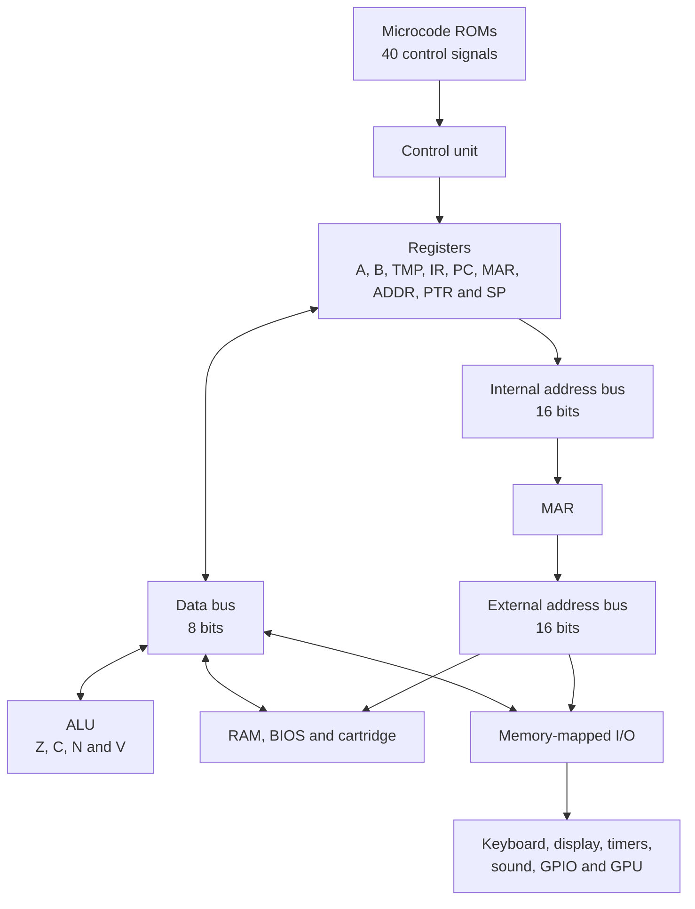

<div align="center">

<h1>WALL-8 — 8-Bit Computer</h1>

<p>
The <strong>WALL-8</strong> is an educational, modular computer I built to deepen my knowledge of Digital Electronics and better understand how hardware and a programming language communicate with each other.
</p>

<p>
Instead of integrating the CPU, memory, and peripherals into a single chip, it makes the normally hidden blocks visible through LEDs: registers, ALU, program counter, stack, buses, address decoding, and control ROMs.
</p>

<p>
I designed it this way so I could have it running on a frame on the wall at home :D
</p>

<p>
The idea is to follow the path of each byte and observe how an Assembly instruction becomes electrical signals inside the hardware.
</p>

<p>
The entire system was designed around logic gates from the <strong>74HC</strong> family and a few other simple ICs. It is built entirely with <strong>PTH</strong> components, giving it a retro character inspired by computers from the 1960s and 1970s.
</p>

**Veja a versão em Português 🇧🇷 [aqui](/README-PT_BR.md)**

</div>

---


#### <strong>A **dedicated GPU built with discrete logic** was also developed, capable of generating VGA video at **640 × 480 @ 60 Hz**. Although it is part of the WALL-8, the GPU has its own architecture and development process.

You can learn more about the project and its specifications [here](Hardware/GPU/wall8_GPU_Hardware.md).</strong>

If you're interested, I also made an emulator for it in Python 3.14, available in the repository [here](Software/wall8_emulador.py).

## Table of Contents

- [What is the WALL-8?](#what-is-the-wall-8)
- [Key Features](#key-features)
- [Architecture Overview](#architecture-overview)
- [Quick Specifications](#quick-specifications)
- [How an Instruction Is Executed](#how-an-instruction-is-executed)
- [Memory Map](#memory-map)
- [Boot and BIOS Window](#boot-and-bios-window)
- [I/O Map](#io-map)
- [Configuration and Status Registers](#configuration-and-status-registers)
- [CPU Clock](#cpu-clock)
- [Peripherals](#peripherals)
- [Video Interface](#video-interface)
- [Instruction Set](#instruction-set)
- [Programming the WALL-8](#programming-the-wall-8)
- [Project Files and Tools](#project-files-and-tools)
- [Documentation](#documentation)
- [Credits](#credits)

## What is the WALL-8?

The WALL-8 is, at the same time:

- an **8-bit CPU**, with two general-purpose registers and its own ALU;
- a **64 KiB microcomputer**, with RAM, BIOS, cartridge, and I/O sharing the same address space;
- a platform for studying **microarchitecture**, since each instruction is divided into microsteps;
- a modular system designed for a keyboard, display, sound, cartridge, external GPU, and future expansions.

The core uses **74HC** logic ICs, parallel memories, and conventional components. The video board is an independent module connected to the I/O bus and equipped with its own VRAM.

## Key Features

- 8-bit data bus;
- 16-bit internal and external address buses;
- 64 KiB address space;
- control through five microcode ROMs, forming a 40-bit control word;
- 76 currently defined opcodes;
- `A`, `B`, `TMP`, `IR`, `PC`, `MAR`, `ADDR`, `PTR`, `SP`, and flag registers;
- `Z`, `C`, `N`, and `V` flags;
- 32 KiB of RAM in normal mode;
- 27C512 EPROM used as the BIOS, with a boot window of up to 40 KiB;
- 20 KiB cartridge region;
- 4 KiB of memory-mapped I/O;
- selectable clock from 125 kHz to 16 MHz;
- 8-bit keyboard, four seven-segment displays, timers, sound, and detection signals;
- connector for an external video board with text and monochrome graphics modes;
- program assembly with [customasm](https://github.com/hlorenzi/customasm).

## Architecture Overview



There are three main paths:

1. The 8-bit **Data Bus** carries opcodes, operands, and data.
2. The 16-bit **Internal Address Bus** moves addresses among `PC`, `ADDR`, `PTR`, `SP`, and `MAR`.
3. The 16-bit **External Address Bus** comes from `MAR` and selects RAM, BIOS, cartridge, or I/O.

`MAR` separates the address being prepared internally from the address presented to external devices. This allows the microcode to build a new address without immediately changing the ongoing memory cycle.

## Quick Specifications

| Item | Specification |
|---|---|
| Architecture | Discrete 8-bit CPU |
| Main logic family | 74HC |
| Logic supply | 5 V |
| Data Bus | 8 bits |
| Internal Address Bus | 16 bits |
| External Address Bus | 16 bits |
| Address space | 64 KiB (`0x0000` to `0xFFFF`) |
| Reference clock | 16 MHz crystal |
| Selectable clocks | 16 MHz, 8 MHz, 4 MHz, 2 MHz, 1 MHz, 500 kHz, 250 kHz, and 125 kHz |
| Control | 5 microcode ROMs × 8 bits |
| Microcode address | 8 opcode bits + 4 flags + 4 microstep bits |
| Microsteps | `T0` to `T15` |
| Current ISA | 76 opcodes |
| Data registers | `A`, `B`, and `TMP`, all 8-bit |
| Address registers | `PC`, `MAR`, `ADDR`, `PTR`, and `SP`, all 16-bit |
| Flags | `Z`, `C`, `N`, and `V` |
| Normal RAM | 32 KiB |
| Resident BIOS | 8 KiB after the overlay is released |
| ROM available at boot | 40 KiB, without RAM |
| Cartridge | 20 KiB |
| I/O | 4 KiB memory-mapped |

## How an Instruction Is Executed

Each opcode selects a sequence in the microcode ROMs. The address of each ROM location is formed as follows:

```text
A0-A7   = opcode from IR
A8-A11  = Z, C, N and V flags
A12-A15 = microstep T0-T15
```

Numerically:

```text
microROM_address = opcode | (flags << 8) | (step << 12)
```

The five ROMs are read in parallel. Together, they produce the 40 signals that control register outputs, loads, ALU, memory, stack, pointer, and the advance or reset of the microsequence.

### Common Fetch

All instructions begin by fetching the opcode:

```text
T0: PC -> internal bus -> MAR
T1: MEM[MAR] -> IR; PC++
```

After `T1`, the sequence depends on the opcode and flags. At the end, the step-counter reset signal returns execution to `T0` to fetch the next instruction.

### Main Registers

| Register | Width | Function |
|---|---:|---|
| `A` | 8 bits | Accumulator and first ALU operand |
| `B` | 8 bits | Second operand and auxiliary register |
| `TMP` | 8 bits | Preserves values during immediate instructions and `STI` |
| `IR` | 8 bits | Holds the current opcode |
| `PC` | 16 bits | Address of the next instruction |
| `MAR` | 16 bits | Drives the external address bus |
| `ADDR` | 16 bits | Assembles absolute addresses received in two bytes |
| `PTR` | 16 bits | Programmable pointer for indirect access |
| `SP` | 16 bits | Stack pointer, which grows toward lower addresses |

### Flags

| Flag | Meaning |
|---|---|
| `Z` | Result equals `0x00` |
| `C` | Carry from addition, *not borrow* from subtraction, or shifted-out bit |
| `N` | Copy of bit 7 of the result |
| `V` | Signed arithmetic overflow |

The flags directly contribute to the addresses of the microcode ROMs. Therefore, a conditional jump can have a different microsequence depending on the state of `Z`, `C`, `N`, or `V`.

## Memory Map

This is the map used after the BIOS releases the RAM in the lower region:

| Range | Size | Device | Use |
|---|---:|---|---|
| `0x0000-0x7FFF` | 32 KiB | RAM | Programs, variables, buffers, and stack |
| `0x8000-0x9FFF` | 8 KiB | BIOS/ROM | Resident code and system routines |
| `0xA000-0xEFFF` | 20 KiB | Cartridge | External program or data |
| `0xF000-0xFFFF` | 4 KiB | I/O | Memory-mapped peripherals |

Since I/O shares the same address space, there are no special port instructions. Software uses `LDA`, `STA`, or `STI`:

```asm
LDA $F300          ; read SYSTEM_STATUS
STI $F400, #$12    ; configure sound
```

## Boot and BIOS Window

The `/BOOT_ROM_EN` signal is active-low and controls which device responds between `0x0000` and `0x7FFF`.

### Overlay active: `/BOOT_ROM_EN = 0`

On reset, the EPROM responds to a **continuous 40 KiB window**:

| CPU range | Device | Physical address in the 27C512 |
|---|---|---|
| `0x0000-0x7FFF` | ROM | `0x0000-0x7FFF` |
| `0x8000-0x9FFF` | ROM | `0x8000-0x9FFF` |

The 27C512 address pins `A0-A15` are directly connected to the corresponding bus bits. Therefore, the first 32 KiB **are not an automatic repetition** of the upper 8 KiB: the ROM image is read normally from offset `0x0000` through `0x9FFF`.

In this state:

- `PC` starts at `0x0000` and finds valid code in ROM;
- the CPU can use up to 40 KiB of ROM program space;
- RAM is not accessible;
- the system can remain in this state indefinitely if the application does not need RAM.

### Overlay released: `/BOOT_ROM_EN = 1`

After software writes `1` to bit 0 of `CPU_CFG`:

| Range | Device |
|---|---|
| `0x0000-0x7FFF` | RAM |
| `0x8000-0x9FFF` | Resident ROM |

To make this transition safely, the instruction that releases the overlay and all code that will continue executing must reside in the region from `0x8000` to `0x9FFF`. This part of the BIOS must fit within 8 KiB.

Example that keeps 16 MHz and releases RAM:

```asm
STI $F500, #$01    ; /BOOT_ROM_EN=1 and CLK_B[2:0]=000
```

## I/O Map

The `0xF000-0xFFFF` block is divided by a `74HC138`. Since `A11` does not participate in the subdecoding, each main page has a mirror 2 KiB above it.

| Main page | Mirror | Module |
|---|---|---|
| `0xF000-0xF0FF` | `0xF800-0xF8FF` | Keyboard |
| `0xF100-0xF1FF` | `0xF900-0xF9FF` | Display |
| `0xF200-0xF2FF` | `0xFA00-0xFAFF` | Video/GPU |
| `0xF300-0xF3FF` | `0xFB00-0xFBFF` | Status and timers |
| `0xF400-0xF4FF` | `0xFC00-0xFCFF` | Sound |
| `0xF500-0xF5FF` | `0xFD00-0xFDFF` | Configuration/GPIO |
| `0xF600-0xF6FF` | `0xFE00-0xFEFF` | CART_IO |
| `0xF700-0xF7FF` | `0xFF00-0xFFFF` | Free |

### Addresses Used

| Address | Name | Access | Function |
|---|---|:---:|---|
| `0xF000` | `KEY_DATA` | R | Byte received from the keyboard |
| `0xF100` | `DISPLAY_LOW` | W | Byte for the two lower digits |
| `0xF101` | `DISPLAY_HIGH` | W | Byte for the two upper digits |
| `0xF200` | `VIDEO_DATA` | R/W | Byte write; result of the last requested read |
| `0xF201` | `VIDEO_CTRL` | W | Mode, pages, cursor, increment, and character bank |
| `0xF202` | `VIDEO_X` | W | Character or byte column of the next operation |
| `0xF203` | `VIDEO_Y` | W | Row of the next operation |
| `0xF204` | `VIDEO_STATUS` | R | BUSY and CURSOR_END |
| `0xF205` | `READ_REQ` | W | Requests a VRAM read at X/Y; data ignored |
| `0xF206` | `CLEAR_REQ` | W | Requests clearing the page accessed by the CPU; data ignored |
| `0xF207` | `CURSOR_END_RESET` | W | Clears CURSOR_END without changing X/Y; data ignored |
| `0xF300` | `SYSTEM_STATUS` | R/W | Status read; writing clears the timers |
| `0xF400` | `SOUND_CFG` | W | Tone and noise configuration |
| `0xF500` | `CPU_CFG` | W | ROM overlay and clock selection |
| `0xF501` | `PERIPH_CFG` | W | Display mode and LEDs |

The same registers appear at their corresponding mirrored addresses. For example, `VIDEO_STATUS` can also be read at `0xFA04`.

## Configuration and Status Registers

### `SYSTEM_STATUS` — `0xF300`

| Bit | Name | Active state | Meaning |
|---:|---|---|---|
| 0 | `TIMER_1MS` | `1` | Nominal 1 ms timer event |
| 1 | `TIMER_500MS` | `1` | 500 ms timer event |
| 2 | Reserved | — | Returns zero |
| 3 | Reserved | — | Returns zero |
| 4 | `/CARD_DETECT` | `0` | Cartridge connected |
| 5 | `/VIDEO_DETECT` | `0` | Video board connected |
| 6 | `/KEYBOARD_DETECT` | `0` | Keyboard connected |
| 7 | `KEY_READY` | `1` | A keyboard byte is ready |

The timer architecturally named `TIMER_1MS` operates at **1024 Hz**, so its actual period is **0.9765625 ms**. This approximation is intentional and simplifies the clock divider.

Any write to the status page generates `/TIMER_RESET` and clears the timer flip-flops. The presence bits and `KEY_READY` are not changed by this write.

### `SOUND_CFG` — `0xF400`

| Bit | Name | Meaning |
|---:|---|---|
| 0 | `NOISE_EN` | `1` enables the noise generator; `0` turns it off |
| 1 | `TONE_EN` | `1` enables the tone generator; `0` turns it off |
| 2 | `TONE_B0` | Tone selection, bit 0 |
| 3 | `TONE_B1` | Tone selection, bit 1 |
| 4 | `TONE_B2` | Tone selection, bit 2 |
| 5 | `NOISE_B0` | Noise configuration, bit 0 |
| 6 | `NOISE_B1` | Noise configuration, bit 1 |
| 7 | `NOISE_B2` | Noise configuration, bit 2 |

`NOISE_EN` and `TONE_EN` are active-high and do not have slashes in their names. The byte is stored by a `74HC377`.

### `CPU_CFG` — `0xF500`

| Bit | Name | Meaning |
|---:|---|---|
| 0 | `/BOOT_ROM_EN` | `0` enables ROM at `0x0000-0x9FFF`; `1` releases lower RAM |
| 1 | Reserved | Not connected |
| 2 | Reserved | Not connected |
| 3 | Reserved | Not connected |
| 4 | `CLK_B0` | Clock selection, bit 0 |
| 5 | `CLK_B1` | Clock selection, bit 1 |
| 6 | `CLK_B2` | Clock selection, bit 2 |
| 7 | Reserved | Not connected |

The `CLK_B0`, `CLK_B1`, and `CLK_B2` fields represent a normal binary code; they are not active-low signals.

### `PERIPH_CFG` — `0xF501`

| Bit | Name | Meaning |
|---:|---|---|
| 0 | `/DISP_HEX` | `0` selects HEX; `1` selects CHAR |
| 1 | Reserved | Not connected |
| 2 | `/LED_EN` | `0` enables LEDs; `1` disables them |
| 3-7 | Reserved | Not connected |

## CPU Clock

The main crystal runs at 16 MHz. Code `000` does not use any division: it selects **direct bypass** of the main clock.

| `CLK_B2` | `CLK_B1` | `CLK_B0` | Code | CPU Clock |
|:---:|:---:|:---:|:---:|---:|
| 0 | 0 | 0 | `000` | 16 MHz — bypass |
| 0 | 0 | 1 | `001` | 8 MHz |
| 0 | 1 | 0 | `010` | 4 MHz |
| 0 | 1 | 1 | `011` | 2 MHz |
| 1 | 0 | 0 | `100` | 1 MHz |
| 1 | 0 | 1 | `101` | 500 kHz |
| 1 | 1 | 0 | `110` | 250 kHz |
| 1 | 1 | 1 | `111` | 125 kHz |

Since the clock bits occupy `CPU_CFG[6:4]`, some useful values are:

| Goal | Value in `CPU_CFG` |
|---|---:|
| 40 KiB ROM, 16 MHz | `0x00` |
| RAM released, 16 MHz | `0x01` |
| RAM released, 1 MHz | `0x41` |
| RAM released, 125 kHz | `0x71` |

## Peripherals

### Keyboard

`KEY_DATA` provides the eight bits received from the keyboard. Before reading, software can check:

- `/KEYBOARD_DETECT` in `SYSTEM_STATUS[6]`: zero indicates a keyboard is present;
- `KEY_READY` in `SYSTEM_STATUS[7]`: one indicates an available byte.

```asm
LDA $F300
TEST A, #$40
JNZ SEM_TECLADO

TEST A, #$80
JZ SEM_TECLA

LDA $F000
```

### Seven-Segment Display

The WALL-8 has four digits arranged in two bytes:

- `DISPLAY_LOW` controls the lower pair;
- `DISPLAY_HIGH` controls the upper pair;
- each nibble selects the symbol for one digit.

The two 27C512 display EPROMs use the following addressing:

| Pins | Use |
|---|---|
| `A0-A7` | Byte written by the CPU |
| `A8` | `DISP_CLOCK`: `0`: high nibble/left digit; `1`: low nibble/right digit |
| `A9` | `0`: HEX mode; `1`: CHAR mode |
| `A10-A15` | Connected to GND |
| `D0-D6` | Segments A-G, active-low (`0` turns on; `1` turns off) |
| `D7` | Decimal point, unused and held at `1` |

The displays are common-anode. The multiplexer uses two PNP `BC327` transistors, also active-low: `DISP_CLOCK=0` enables the left digits, and `DISP_CLOCK=1` enables the right digits.

The script [`Software/source_file_dispDec/7Seg.py`](Software/source_file_dispDec/7Seg.py) generates `display_low.bin` and `display_high.bin`. Each file contains 65,536 bytes, and both have identical contents; what changes in the circuit is the byte connected to `A0-A7` of each EPROM.

In HEX mode, each nibble displays `0-F`. In CHAR mode, the codes are:

| Code | Symbol | Code | Symbol |
|:---:|:---:|:---:|:---:|
| `0` | space | `8` | `L` |
| `1` | `A` | `9` | `O` |
| `2` | `b` | `A` | `P` |
| `3` | `C` | `B` | `r` |
| `4` | `d` | `C` | `t` |
| `5` | `E` | `D` | `U` |
| `6` | `F` | `E` | `-` |
| `7` | `H` | `F` | `_` |

### Sound

The audio subsystem combines a tone generator and a noise generator. Each generator has three selection bits and an independent enable, allowing beeps, simple effects, and retro-style noise.

### Timers

The system exposes two events through polling:

- `TIMER_1MS`, with an actual frequency of 1024 Hz;
- `TIMER_500MS`, for slow events and visual timing.

A write to `0xF300` clears the stored events.

### Cartridge and Expansion

The `0xA000-0xEFFF` range reserves 20 KiB for cartridge memory, selected by `/CARD_SEL`. Page `Y6` (`0xF600-0xF6FF`, mirrored at `0xFE00-0xFEFF`) is routed to the cartridge through `/CARD_IO_SEL`. The hardware can accommodate ROM, EEPROM, Flash, battery-backed SRAM, logic, or its own peripherals. Presence is indicated by `/CARD_DETECT`.

`Y6` belongs to the cartridge as `CART_IO`. The WALL-8 does not define registers on this page: their offsets and functions are defined by each cartridge's hardware and controlled by the cartridge ROM's own code. `Y7` remains free for future expansion.

## Video Interface

The GPU is a separate board with its own VRAM. This README documents only the interface visible to the CPU; details of VGA timing, VRAM arbitration, font, and circuitry are covered in the [video board specification](Hardware/GPU/wall8_GPU_Hardware.md).

### Registers

| Address | Name | Access | Function |
|---|---|:---:|---|
| `0xF200` | `VIDEO_DATA` | R/W | A write requests storing a byte at X/Y; a read returns the last completed VRAM read. |
| `0xF201` | `VIDEO_CTRL` | W | Persistent settings for mode, pages, cursor, increment, and character bank; no readback. |
| `0xF202` | `VIDEO_X` | W | Character column in text mode or byte column in graphics mode; no readback. |
| `0xF203` | `VIDEO_Y` | W | Row of the next operation; no readback. |
| `0xF204` | `VIDEO_STATUS` | R | `BUSY` in bit 0 and `CURSOR_END` in bit 4; other bits return zero. |
| `0xF205` | `READ_REQ` | W | Any write requests a VRAM read at X/Y; the written byte is ignored. |
| `0xF206` | `CLEAR_REQ` | W | Any write requests CLEAR on the CPU-accessed page; the written byte is ignored. |
| `0xF207` | `CURSOR_END_RESET` | W | Any write clears `CURSOR_END` without changing X/Y; the written byte is ignored. |

The eight offsets appear at `0xF200-0xF207` and in the mirror at `0xFA00-0xFA07`. The GPU decodes only `A2-A0`: the same offsets repeat every eight bytes within each video page. VRAM is accessed indirectly through X/Y/DATA; it does not occupy a direct window in the CPU memory space.

### `VIDEO_CTRL` — `0xF201`

| Bit | Name | Meaning |
|---:|---|---|
| 0 | `MODE_B0` | Mode selection bit 0. |
| 1 | `MODE_B1` | Mode selection bit 1. |
| 2 | `DOUBLE_BUFFER_EN` | 0: CPU and video use page 0. 1: video uses the front page and the CPU accesses the opposite page. |
| 3 | `DISPLAY_PAGE` | Requested display page, 0 or 1; the selection takes effect at the beginning of `VBLANK`. |
| 4 | `CURSOR_VISIBLE` | 1 enables the blinking cursor in text mode; 0 hides it. |
| 5 | `AUTO_INCREMENT` | 1 advances X/Y after each `VIDEO_DATA` write; 0 keeps the position. |
| 6 | `Char_Bank_14` | Bit 0 of the ROM character bank, used in text mode. |
| 7 | `Char_Bank_15` | Bit 1 of the ROM character bank, used in text mode. |

`VIDEO_CTRL` replaces all eight bits on each write and has no guaranteed reset value. Initialize it explicitly and keep a copy in RAM to modify individual fields while preserving the others. `MODE_B1:MODE_B0` = 00 selects 80 × 30 text; 01, 320 × 240 graphics; 10, 160 × 120 graphics; 11 is not an implemented mode. Bits 7:6 select one of the ROM's four character banks.

With `DOUBLE_BUFFER_EN`=1, VRAM is divided into two 16 KiB pages: the CPU reads, writes, and clears the page opposite the displayed one. `DISPLAY_PAGE` is a request applied during `VBLANK`; `VIDEO_STATUS` does not confirm the active page, and `BUSY` neither signals nor confirms this switch. With `DOUBLE_BUFFER_EN`=0, both use page 0.

### `VIDEO_STATUS` — `0xF204`

| Bit | Name | Meaning |
|---:|---|---|
| 0 | `BUSY` | 1 indicates a pending/in-progress read, write, or CLEAR; wait for zero before the next operation. |
| 1-3 | Reserved | Return zero; `VBLANK`, `HBLANK`, and `FRAME` are not exposed to the CPU. |
| 4 | `CURSOR_END` | Latched flag: auto-increment completed the mode's area or CLEAR finished. |
| 5-7 | Reserved | Return zero. |

The GPU performs one VRAM operation at a time. While `BUSY`=1, software can poll `VIDEO_STATUS`, but must wait until `BUSY`=0 before changing `VIDEO_CTRL`, `VIDEO_X`, `VIDEO_Y`, or `VIDEO_DATA`, or writing to the request and acknowledgment offsets. `READ_REQ` and `CLEAR_REQ` are write-triggered actions, not fields of `VIDEO_CTRL`.

### Coordinates and Data Format

| Mode (`VIDEO_CTRL[1:0]`) | `VIDEO_X` | `VIDEO_Y` | Meaning of `VIDEO_DATA` |
|---|---|---|---|
| `00`: 80×30 text | `0-79` | `0-29` | Character code; 80 useful bytes per row |
| `01`: 320×240 graphics | `0-39` | `0-239` | 8 pixels per byte; 40 useful bytes per row |
| `10`: 160×120 graphics | `0-19` | `0-119` | 8 pixels per byte; 20 useful bytes per row |

In text mode, the 8×8 font is doubled vertically only. Graphics modes are scaled 2× and 4×, respectively. In graphics bytes, bit 0 is the leftmost pixel and bit 7 is the rightmost.

`AUTO_INCREMENT` affects only writes to `VIDEO_DATA`: it advances X, moves to the next row, and, after finishing the last row, returns X/Y to (0,0) and sets `CURSOR_END`. The flag does not block further writes and stays set until `CURSOR_END_RESET`, the start of CLEAR, or a general reset. Writing X/Y or changing the mode does not clear this flag; changing the mode also does not reinitialize X/Y.

### Reading and CLEAR

To read VRAM, wait for `BUSY`=0, set X/Y, write any byte to `READ_REQ`, wait again for `BUSY`=0, and read `VIDEO_DATA`. Reading does not increment X/Y; reading `VIDEO_DATA` alone does not start a new VRAM read.

`CLEAR_REQ` resets X/Y to (0,0), clears `CURSOR_END` at the beginning, and fills the valid area of the mode on the CPU-accessed page with 0x00, regardless of `AUTO_INCREMENT`. Once finished, X/Y return to (0,0) and `CURSOR_END` becomes set. In text mode, character 0x00 must be blank in each ROM bank to represent a clear screen.

### Polling `BUSY`

```asm
VIDEO_STATUS = $F204

VIDEO_WAIT:
    LDA VIDEO_STATUS
    TEST A, #$01
    JNZ VIDEO_WAIT
    RET
```

The physical presence of the module is checked separately through `/VIDEO_DETECT` in `SYSTEM_STATUS[5]`.

## Instruction Set

The current ISA contains **76 opcodes** divided into the following groups:

| Group | Examples |
|---|---|
| System | `NOP`, `HLT` |
| Load/store | `LDA`, `LDB`, `STA`, `STB`, `STI` |
| Data movement | `MOV A, B`, `MOV B, A` |
| Pointer | `PTR`, `[PTR]`, `[PTR+]`, `INC PTR`, `DEC PTR` |
| Arithmetic | `ADD`, `SUB`, `INC`, `DEC` |
| Logic | `AND`, `OR`, `XOR`, `NOT`, `TEST` |
| Shift | `SHL`, `SHR` |
| Comparison | `CMP` |
| Branch | `JMP`, `JZ`, `JNZ`, `JC`, `JNC`, `JN`, `JP`, `JV`, `JNV` |
| Stack and subroutines | `SP`, `PUSH`, `POP`, `CALL`, `RET` |

16-bit addresses are encoded in **little-endian** order: low byte first, then high byte. For example:

```asm
LDA $1234
```

is assembled as:

```text
12 34 12
```

See [`Software/wall8_instrucoes.md`](Software/wall8_instrucoes.md) for the full table of opcodes, formats, cycles, flags, and examples.

## Programming the WALL-8

The [`Software/wall8.cpu`](Software/wall8.cpu) file defines the ISA syntax for **customasm**.

### Minimal Example

```asm
#include "wall8.cpu"

SP $7FFF
LDA #$00

loop:
    INC A
    STA $F100
    JMP loop
```

### Assembly

The repository includes the customasm executable for Windows at [`Software/Tools/customasm.exe`](Software/Tools/customasm.exe). The `build.bat` files in the `BIOS`, `CARD`, and `Checkup` directories use this executable to assemble `.asm` files and generate the corresponding `.bin` files.

On Windows, enter the desired directory and run:

```bat
build.bat
```

You can also install [customasm](https://github.com/hlorenzi/customasm) separately and assemble a file manually:

```bash
customasm programa.asm -f binary -o programa.bin
```

Before programming a BIOS, choose one of two strategies:

1. **Continuous ROM:** keep `/BOOT_ROM_EN=0` and use up to 40 KiB from `0x0000` to `0x9FFF`, without RAM.
2. **Boot with RAM:** start at `0x0000`, transfer execution to a resident routine between `0x8000` and `0x9FFF`, and only then write `1` to `/BOOT_ROM_EN`.

When writing software for peripherals, respect the active levels indicated by the signal names: signals with `/` are active-low; names without `/` use positive logic.

## Project Files and Tools


### Hardware

The [`Hardware`](Hardware/) directory contains the Proteus project and the PDF [`Hardware_CPU_Completo.pdf`](Hardware/Hardware_CPU_Completo.pdf), which contains only the electronic schematic sheets. This PDF is useful for direct circuit reference and remains separate from the consolidated technical manual.

### 27C512 Memory Images

The [`Software/27C512`](Software/27C512/) directory contains ready-to-program images:

- `microcode_rom1.bin` through `microcode_rom5.bin`: the five parallel bytes of the microcode word;
- `display_low.bin` and `display_high.bin`: decoding for the four displays in HEX and CHAR modes.

[`Gerador_Microcodigo.py`](Software/Gerador_Microcodigo.py) creates five 65,536-byte images, one for each control ROM. [`7Seg.py`](Software/source_file_dispDec/7Seg.py) creates the two 65,536-byte display images.

### BIOS

The [`Software/BIOS`](Software/BIOS/) directory contains two versions with different purposes:

| File | Purpose |
|---|---|
| `bios_default.asm` | Minimal BIOS, used as a starting point for a simple program, equivalent to a WALL-8 “Hello World” |
| [`wall8_bios_monitor_v5.asm`](Software/BIOS/wall8_bios_monitor_v5.asm) | Main BIOS, with monitor and terminal |

The corresponding `.bin` files are in the same directory and can be regenerated with `build.bat`.

### Cartridges

The [`Software/CARD`](Software/CARD/) directory contains images for the cartridge region:

| File | Purpose |
|---|---|
| `CARD_default.asm` | Minimal cartridge structure, equivalent to the default BIOS approach |
| `CARD_01.asm` | First example program |
| `CARD_02.asm` | Second example program |

Each example has, or can generate, its corresponding `.bin` using `build.bat`.

### Checkup

[`Software/Checkup`](Software/Checkup/) is the WALL-8 general diagnostic program. It was created to check the integrated operation of the machine, including memory, timers, keyboard, video, sound, cartridge, and presence signals.

- `wall8_checkup_completo_v1.asm`: diagnostic source code;
- `wall8_checkup_completo_v1.bin`: ready-to-run image;
- `wall8_checkup_completo_v1_guia.md`: test procedure and interpretation;
- `build.bat`: binary image generation.

### Auxiliary Tools

| Path | Function |
|---|---|
| [`Software/Tools/customasm.exe`](Software/Tools/customasm.exe) | Assembler used by the `build.bat` scripts |
| [`Software/wall8.cpu`](Software/wall8.cpu) | WALL-8 ISA rules for customasm |
| [`Software/Gerador_Microcodigo.py`](Software/Gerador_Microcodigo.py) | Microcode ROM generation |
| [`Software/source_file_dispDec/7Seg.py`](Software/source_file_dispDec/7Seg.py) | Display ROM generation |
| [`Software/wall8_emulador.py`](Software/wall8_emulador.py) | WALL-8 simulator |
| [`Software/Gerador_ROM_Caracteres.py`](Software/Gerador_ROM_Caracteres.py) | GPU character bank generator |

## Documentation

- [CPU Technical Reference Manual — revision 1.3](WALL-8_Manual_de_Referencia_Tecnica_Rev1.3.odt) — consolidated document in ODT format;
- [GPU Technical Reference Manual — revision 1.0](Hardware/GPU/WALL-8_GPU_Manual_de_Referencia_Tecnica_Rev1.0.odt) — consolidated document in ODT format;
- [Complete Instruction Reference](Software/wall8_instrucoes.md) — opcodes, bytes, cycles, flags, and examples;
- [Video Board Specification](Hardware/GPU/wall8_GPU_Hardware.md) — protocol, registers, modes, and GPU architecture;
- [Checkup Guide](Software/Checkup/wall8_checkup_completo_v1_guia.md) — test sequence for the general diagnostics;
- [Complete Electronic Schematic](Hardware/Hardware_CPU_Completo.pdf) — sheets exported from Proteus;
- [Complete GPU Electronic Schematic](Hardware/GPU/Hardware_GPU_Completo.pdf) — sheets exported from Proteus;
- [Architecture Flowchart](fluxograma_A4_horizontal.pdf) — graphical overview in A4 format.


## Credits

WALL-8 project and architecture: **Vinicius Dias de Jesus**.

The Assembly examples and CPU definition file use the [customasm](https://github.com/hlorenzi/customasm) project by **hlorenzi**. Thanks to the author and contributors for providing a flexible assembler for custom architectures.
