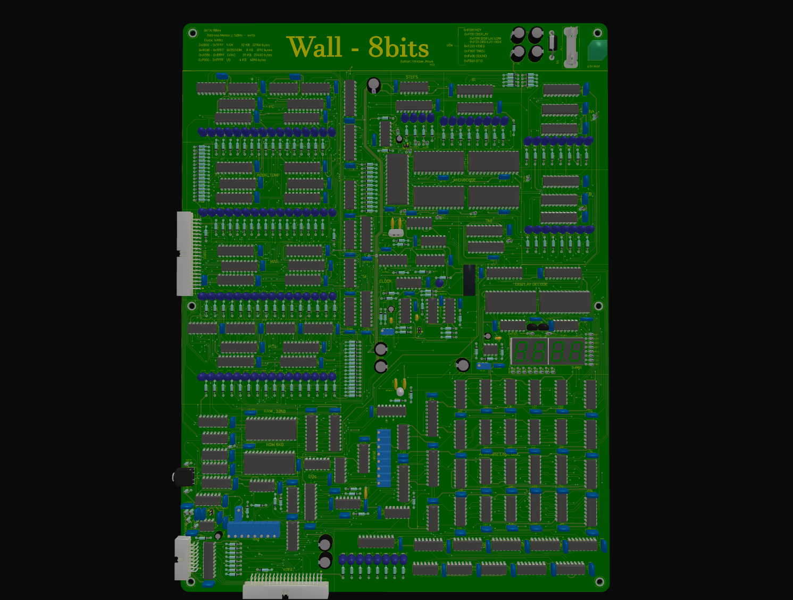
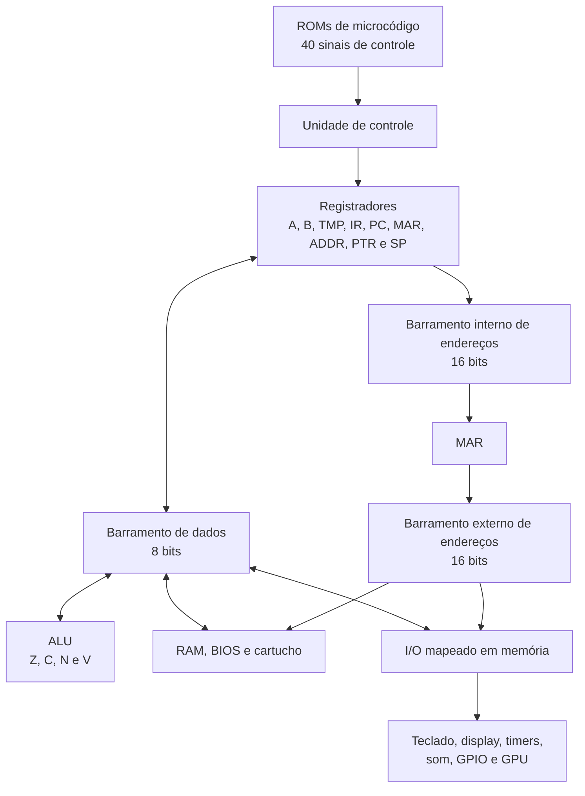

# WALL-8  8 Bits Computer


O **WALL-8** é um projeto de computador didático e modular que fiz para me aprofundar mais em Eletronica Digital e entender como o Hardware e uma Linguagem de Programação se comunicam. Em vez de concentrar a CPU, a memória e os periféricos em um único circuito integrado, ele torna visíveis com leds os blocos que normalmente ficam escondidos: registradores, ALU, contador de programa, pilha, barramentos, decodificação de endereços e ROMs de controle.Pensei assim para deixar ele funcionando em um quadro na parede de casa :D. 


O objetivo é permitir acompanhar o caminho de cada byte e entender como uma instrução de Assembly se transforma em sinais elétricos no hardware.

o sistema todo foi pensado em usar portas logicas da familia 74HC e mais alguns CIs simples, Toda em PTH para Ter uma caracteristica mais retro, comparavel e inspiravel em computadores da decada de 60/70.



Caso tenha interesse fiz tambem um emulador dele em python 3.14 presente no repositorio [aqui](Software/wall8_emulador.py).

## Sumário

- [O que é o WALL-8](#o-que-é-o-wall-8)
- [Principais características](#principais-características)
- [Visão geral da arquitetura](#visão-geral-da-arquitetura)
- [Especificações rápidas](#especificações-rápidas)
- [Como uma instrução é executada](#como-uma-instrução-é-executada)
- [Mapa de memória](#mapa-de-memória)
- [Boot e janela da BIOS](#boot-e-janela-da-bios)
- [Mapa de I/O](#mapa-de-io)
- [Registradores de configuração e status](#registradores-de-configuração-e-status)
- [Clock da CPU](#clock-da-cpu)
- [Periféricos](#periféricos)
- [Interface de vídeo](#interface-de-vídeo)
- [Conjunto de instruções](#conjunto-de-instruções)
- [Programando o WALL-8](#programando-o-wall-8)
- [Arquivos e ferramentas do projeto](#arquivos-e-ferramentas-do-projeto)
- [Documentação](#documentação)
- [Estado atual e próximos passos](#estado-atual-e-próximos-passos)
- [Créditos](#créditos)

## O que é o WALL-8

O WALL-8 é, ao mesmo tempo:

- uma **CPU de 8 bits**, com dois registradores de uso geral e ALU própria;
- um **microcomputador de 64 KiB**, com RAM, BIOS, cartucho e I/O no mesmo espaço de endereços;
- uma plataforma de estudo de **microarquitetura**, pois cada instrução é dividida em microetapas;
- um sistema modular, preparado para teclado, display, som, cartucho, GPU externa e futuras expansões.

O núcleo utiliza CIs lógicos da família **74HC**, memórias paralelas e componentes convencionais. A placa de vídeo é um módulo independente, conectado ao barramento de I/O e equipado com VRAM própria.

## Principais características

- barramento de dados de 8 bits;
- barramentos de endereços interno e externo de 16 bits;
- espaço de endereçamento de 64 KiB;
- controle por cinco ROMs de microcódigo, totalizando uma palavra de controle de 40 bits;
- 76 opcodes atualmente definidos;
- registradores `A`, `B`, `TMP`, `IR`, `PC`, `MAR`, `ADDR`, `PTR`, `SP` e flags;
- flags `Z`, `C`, `N` e `V`;
- RAM de 32 KiB no modo normal;
- EPROM 27C512 usada como BIOS, com janela de boot de até 40 KiB;
- região de cartucho de 20 KiB;
- 4 KiB de I/O mapeado em memória;
- clock selecionável de 125 kHz a 16 MHz;
- teclado de 8 bits, quatro displays de sete segmentos, timers, som e sinais de detecção;
- conector para placa de vídeo externa com modos texto e gráficos monocromáticos;
- montagem de programas com o [customasm](https://github.com/hlorenzi/customasm).

## Visão geral da arquitetura



Existem três caminhos principais:

1. O **Data Bus** de 8 bits transporta opcodes, operandos e dados.
2. O **Internal Address Bus** de 16 bits move endereços entre `PC`, `ADDR`, `PTR`, `SP` e `MAR`.
3. O **External Address Bus** de 16 bits sai do `MAR` e seleciona RAM, BIOS, cartucho ou I/O.

O `MAR` separa o endereço que está sendo preparado internamente do endereço apresentado aos dispositivos externos. Isso permite que o microcódigo monte um novo endereço sem alterar imediatamente o ciclo de memória em andamento.

## Especificações rápidas

| Item | Especificação |
|---|---|
| Arquitetura | CPU discreta de 8 bits |
| Família lógica principal | 74HC |
| Alimentação lógica | 5 V |
| Data Bus | 8 bits |
| Address Bus interno | 16 bits |
| Address Bus externo | 16 bits |
| Espaço de endereços | 64 KiB (`0x0000` a `0xFFFF`) |
| Clock de referência | Cristal de 16 MHz |
| Clocks selecionáveis | 16 MHz, 8 MHz, 4 MHz, 2 MHz, 1 MHz, 500 kHz, 250 kHz e 125 kHz |
| Controle | 5 ROMs de microcódigo × 8 bits |
| Endereço de microcódigo | 8 bits de opcode + 4 flags + 4 bits de microstep |
| Microsteps | `T0` a `T15` |
| ISA atual | 76 opcodes |
| Registradores de dados | `A`, `B` e `TMP`, todos de 8 bits |
| Registradores de endereço | `PC`, `MAR`, `ADDR`, `PTR` e `SP`, todos de 16 bits |
| Flags | `Z`, `C`, `N` e `V` |
| RAM normal | 32 KiB |
| BIOS residente | 8 KiB após a liberação do overlay |
| ROM disponível no boot | 40 KiB, sem RAM |
| Cartucho | 20 KiB |
| I/O | 4 KiB mapeados em memória |

## Como uma instrução é executada

Cada opcode seleciona uma sequência nas ROMs de microcódigo. O endereço de cada posição das ROMs é formado assim:

```text
A0-A7   = opcode do IR
A8-A11  = flags Z, C, N e V
A12-A15 = microstep T0-T15
```

Em termos numéricos:

```text
endereço_da_microROM = opcode | (flags << 8) | (step << 12)
```

As cinco ROMs são lidas em paralelo. Juntas, elas produzem os 40 sinais que comandam saídas de registradores, cargas, ALU, memória, pilha, ponteiro e avanço ou reinício da microsequência.

### Fetch comum

Todas as instruções começam com a busca do opcode:

```text
T0: PC -> barramento interno -> MAR
T1: MEM[MAR] -> IR; PC++
```

Depois de `T1`, a sequência depende do opcode e das flags. Ao final, o sinal de reset do contador de passos retorna a execução a `T0` para buscar a próxima instrução.

### Registradores principais

| Registrador | Largura | Função |
|---|---:|---|
| `A` | 8 bits | Acumulador e primeiro operando da ALU |
| `B` | 8 bits | Segundo operando e registrador auxiliar |
| `TMP` | 8 bits | Preserva valores durante instruções imediatas e `STI` |
| `IR` | 8 bits | Mantém o opcode atual |
| `PC` | 16 bits | Endereço da próxima instrução |
| `MAR` | 16 bits | Dirige o barramento externo de endereços |
| `ADDR` | 16 bits | Monta endereços absolutos recebidos em dois bytes |
| `PTR` | 16 bits | Ponteiro programável para acesso indireto |
| `SP` | 16 bits | Ponteiro da pilha, que cresce em direção aos endereços menores |

### Flags

| Flag | Significado |
|---|---|
| `Z` | Resultado igual a `0x00` |
| `C` | Carry da soma, *not borrow* da subtração ou bit deslocado |
| `N` | Cópia do bit 7 do resultado |
| `V` | Overflow em aritmética com sinal |

As flags participam diretamente do endereço das ROMs de microcódigo. Por isso, um jump condicional pode ter uma microsequência diferente conforme o estado de `Z`, `C`, `N` ou `V`.

## Mapa de memória

Este é o mapa usado depois que a BIOS libera a RAM da região baixa:

| Faixa | Tamanho | Dispositivo | Uso |
|---|---:|---|---|
| `0x0000-0x7FFF` | 32 KiB | RAM | Programas, variáveis, buffers e pilha |
| `0x8000-0x9FFF` | 8 KiB | BIOS/ROM | Código residente e rotinas do sistema |
| `0xA000-0xEFFF` | 20 KiB | Cartucho | Programa ou dados externos |
| `0xF000-0xFFFF` | 4 KiB | I/O | Periféricos mapeados em memória |

Como o I/O faz parte do mesmo espaço de endereços, não existem instruções especiais de porta. O software usa `LDA`, `STA` ou `STI`:

```asm
LDA $F300          ; lê SYSTEM_STATUS
STI $F400, #$12    ; configura o som
```

## Boot e janela da BIOS

O sinal `/BOOT_ROM_EN` é ativo em nível baixo e controla qual dispositivo responde entre `0x0000` e `0x7FFF`.

### Overlay ativo: `/BOOT_ROM_EN = 0`

No reset, a EPROM responde a uma janela **contínua de 40 KiB**:

| Faixa da CPU | Dispositivo | Endereço físico na 27C512 |
|---|---|---|
| `0x0000-0x7FFF` | ROM | `0x0000-0x7FFF` |
| `0x8000-0x9FFF` | ROM | `0x8000-0x9FFF` |

Os pinos de endereço `A0-A15` da 27C512 estão ligados diretamente aos bits correspondentes do barramento. Portanto, os primeiros 32 KiB **não são uma repetição automática** dos 8 KiB superiores: o arquivo da ROM é lido normalmente do offset `0x0000` até `0x9FFF`.

Nesse estado:

- o `PC` inicia em `0x0000` e encontra código válido na ROM;
- a CPU pode usar até 40 KiB de programa em ROM;
- a RAM não fica acessível;
- o sistema pode permanecer assim indefinidamente se a aplicação não precisar de RAM.

### Overlay liberado: `/BOOT_ROM_EN = 1`

Depois que o software grava `1` no bit 0 de `CPU_CFG`:

| Faixa | Dispositivo |
|---|---|
| `0x0000-0x7FFF` | RAM |
| `0x8000-0x9FFF` | ROM residente |

Para fazer essa transição com segurança, a instrução que libera o overlay e todo o código que continuará executando devem estar na parte residente entre `0x8000` e `0x9FFF`. Essa parte da BIOS deve caber em 8 KiB.

Exemplo mantendo 16 MHz e liberando a RAM:

```asm
STI $F500, #$01    ; /BOOT_ROM_EN=1 e CLK_B[2:0]=000
```

## Mapa de I/O

O bloco `0xF000-0xFFFF` é dividido por um `74HC138`. Como `A11` não participa do subdecode, cada página principal possui um espelho 2 KiB acima.

| Página principal | Espelho | Módulo |
|---|---|---|
| `0xF000-0xF0FF` | `0xF800-0xF8FF` | Teclado |
| `0xF100-0xF1FF` | `0xF900-0xF9FF` | Display |
| `0xF200-0xF2FF` | `0xFA00-0xFAFF` | Vídeo/GPU |
| `0xF300-0xF3FF` | `0xFB00-0xFBFF` | Status e timers |
| `0xF400-0xF4FF` | `0xFC00-0xFCFF` | Som |
| `0xF500-0xF5FF` | `0xFD00-0xFDFF` | Configuração/GPIO |
| `0xF600-0xF6FF` | `0xFE00-0xFEFF` | Livre |
| `0xF700-0xF7FF` | `0xFF00-0xFFFF` | Livre |

### Endereços utilizados

| Endereço | Nome | Acesso | Função |
|---|---|:---:|---|
| `0xF000` | `KEY_DATA` | R | Byte recebido do teclado |
| `0xF100` | `DISPLAY_LOW` | W | Byte dos dois dígitos inferiores |
| `0xF101` | `DISPLAY_HIGH` | W | Byte dos dois dígitos superiores |
| `0xF200` | `VIDEO_DATA` | R/W | Transferência de dados com a GPU |
| `0xF201` | `VIDEO_CMD` | W | Comandos e seleção de modo da GPU |
| `0xF202` | `VIDEO_X` | R/W | Posição horizontal da GPU |
| `0xF203` | `VIDEO_Y` | R/W | Posição vertical da GPU |
| `0xF204` | `VIDEO_STATUS` | R | Estado da GPU |
| `0xF300` | `SYSTEM_STATUS` | R/W | Leitura de status; escrita limpa os timers |
| `0xF400` | `SOUND_CFG` | W | Configuração de tom e ruído |
| `0xF500` | `CPU_CFG` | W | Overlay da ROM e seleção do clock |
| `0xF501` | `PERIPH_CFG` | W | Modo do display e LEDs |

Os mesmos registradores aparecem nos endereços espelhados correspondentes. Por exemplo, `VIDEO_STATUS` também pode ser lido em `0xFA04`.

## Registradores de configuração e status

### `SYSTEM_STATUS` — `0xF300`

| Bit | Nome | Estado ativo | Significado |
|---:|---|---|---|
| 0 | `TIMER_1MS` | `1` | Evento do timer nominal de 1 ms |
| 1 | `TIMER_500MS` | `1` | Evento do timer de 500 ms |
| 2 | reservado | — | Retorna zero |
| 3 | reservado | — | Retorna zero |
| 4 | `/CARD_DETECT` | `0` | Cartucho conectado |
| 5 | `/VIDEO_DETECT` | `0` | Placa de vídeo conectada |
| 6 | `/KEYBOARD_DETECT` | `0` | Teclado conectado |
| 7 | `KEY_READY` | `1` | Existe um byte de teclado pronto |

O timer chamado arquiteturalmente de `TIMER_1MS` opera a **1024 Hz**, portanto seu período real é **0,9765625 ms**. A aproximação é intencional e simplifica o divisor de clock.

Qualquer escrita na página de status gera `/TIMER_RESET` e limpa os flip-flops dos timers. Os bits de presença e `KEY_READY` não são alterados por essa escrita.

### `SOUND_CFG` — `0xF400`

| Bit | Nome | Significado |
|---:|---|---|
| 0 | `NOISE_EN` | `1` habilita o gerador de ruído; `0` desliga |
| 1 | `TONE_EN` | `1` habilita o gerador de tom; `0` desliga |
| 2 | `TONE_B0` | Seleção de tom, bit 0 |
| 3 | `TONE_B1` | Seleção de tom, bit 1 |
| 4 | `TONE_B2` | Seleção de tom, bit 2 |
| 5 | `NOISE_B0` | Configuração de ruído, bit 0 |
| 6 | `NOISE_B1` | Configuração de ruído, bit 1 |
| 7 | `NOISE_B2` | Configuração de ruído, bit 2 |

`NOISE_EN` e `TONE_EN` são ativos em nível alto e não levam barra em seus nomes. O byte é armazenado por um `74HC377`.

### `CPU_CFG` — `0xF500`

| Bit | Nome | Significado |
|---:|---|---|
| 0 | `/BOOT_ROM_EN` | `0` habilita a ROM em `0x0000-0x9FFF`; `1` libera a RAM baixa |
| 1 | reservado | Não conectado |
| 2 | reservado | Não conectado |
| 3 | reservado | Não conectado |
| 4 | `CLK_B0` | Seleção do clock, bit 0 |
| 5 | `CLK_B1` | Seleção do clock, bit 1 |
| 6 | `CLK_B2` | Seleção do clock, bit 2 |
| 7 | reservado | Não conectado |

Os campos `CLK_B0`, `CLK_B1` e `CLK_B2` representam um código binário normal; não são sinais ativos em nível baixo.

### `PERIPH_CFG` — `0xF501`

| Bit | Nome | Significado |
|---:|---|---|
| 0 | `/DISP_HEX` | `0` seleciona HEX; `1` seleciona CHAR |
| 1 | reservado | Não conectado |
| 2 | `/LED_EN` | `0` habilita os LEDs; `1` desabilita |
| 3-7 | reservado | Não conectado |

## Clock da CPU

O cristal principal é de 16 MHz. O código `000` não passa por divisão: ele seleciona o **bypass direto** do clock principal.

| `CLK_B2` | `CLK_B1` | `CLK_B0` | Código | Clock da CPU |
|:---:|:---:|:---:|:---:|---:|
| 0 | 0 | 0 | `000` | 16 MHz — bypass |
| 0 | 0 | 1 | `001` | 8 MHz |
| 0 | 1 | 0 | `010` | 4 MHz |
| 0 | 1 | 1 | `011` | 2 MHz |
| 1 | 0 | 0 | `100` | 1 MHz |
| 1 | 0 | 1 | `101` | 500 kHz |
| 1 | 1 | 0 | `110` | 250 kHz |
| 1 | 1 | 1 | `111` | 125 kHz |

Como os bits de clock ocupam `CPU_CFG[6:4]`, alguns valores úteis são:

| Objetivo | Valor em `CPU_CFG` |
|---|---:|
| ROM de 40 KiB, 16 MHz | `0x00` |
| RAM liberada, 16 MHz | `0x01` |
| RAM liberada, 1 MHz | `0x41` |
| RAM liberada, 125 kHz | `0x71` |

## Periféricos

### Teclado

`KEY_DATA` entrega os oito bits recebidos do teclado. Antes de ler, o software pode consultar:

- `/KEYBOARD_DETECT` em `SYSTEM_STATUS[6]`: zero indica teclado presente;
- `KEY_READY` em `SYSTEM_STATUS[7]`: um indica byte disponível.

```asm
LDA $F300
TEST A, #$40
JNZ SEM_TECLADO

TEST A, #$80
JZ SEM_TECLA

LDA $F000
```

### Display de sete segmentos

O WALL-8 possui quatro dígitos organizados em dois bytes:

- `DISPLAY_LOW` controla o par inferior;
- `DISPLAY_HIGH` controla o par superior;
- cada nibble seleciona o símbolo de um dígito.

As duas EPROMs 27C512 do display usam o seguinte endereçamento:

| Pinos | Uso |
|---|---|
| `A0-A7` | Byte escrito pela CPU |
| `A8` | `0`: nibble baixo/dígito direito; `1`: nibble alto/dígito esquerdo |
| `A9` | `0`: modo HEX; `1`: modo CHAR |
| `A10-A15` | Ligados ao GND |
| `D0-D6` | Segmentos A-G |
| `D7` | Ponto decimal, não utilizado |

O script [`Software/source_file_dispDec/7Seg.py`](Software/source_file_dispDec/7Seg.py) gera `display_low.bin` e `display_high.bin`. Cada arquivo possui 65.536 bytes e os dois têm conteúdo idêntico; o que muda no circuito é o byte ligado a `A0-A7` de cada EPROM.

No modo HEX, cada nibble mostra `0-F`. No modo CHAR, os códigos são:

| Código | Símbolo | Código | Símbolo |
|:---:|:---:|:---:|:---:|
| `0` | espaço | `8` | `L` |
| `1` | `A` | `9` | `O` |
| `2` | `b` | `A` | `P` |
| `3` | `C` | `B` | `r` |
| `4` | `d` | `C` | `t` |
| `5` | `E` | `D` | `U` |
| `6` | `F` | `E` | `-` |
| `7` | `H` | `F` | `_` |

### Som

O subsistema de áudio combina um gerador de tom e um gerador de ruído. Cada gerador possui três bits de seleção e um enable independente, permitindo beeps, efeitos simples e ruído de estilo retrô.

### Timers

O sistema expõe dois eventos por polling:

- `TIMER_1MS`, com frequência real de 1024 Hz;
- `TIMER_500MS`, para eventos lentos e temporização visual.

Uma escrita em `0xF300` limpa os eventos armazenados.

### Cartucho e expansão

A faixa `0xA000-0xEFFF` reserva 20 KiB para cartuchos. O hardware pode acomodar ROM, EEPROM, Flash, SRAM com bateria ou outra placa compatível. A presença é indicada por `/CARD_DETECT`.

As páginas `Y6` e `Y7` do I/O permanecem livres para novos dispositivos.

## Interface de vídeo

A GPU é uma placa separada com VRAM própria. O README documenta apenas o contrato visível pela CPU; detalhes de temporização VGA, arbitragem da VRAM, fonte e circuito ficam na [especificação da placa de vídeo](Software/wall8_placa_video.md).

### Registradores

| Endereço | Nome | Acesso | Função |
|---|---|:---:|---|
| `0xF200` | `VIDEO_DATA` | R/W | Grava um byte na posição atual ou devolve a última leitura concluída |
| `0xF201` | `VIDEO_CMD` | W | Executa um comando completo |
| `0xF202` | `VIDEO_X` | R/W | Coluna/célula horizontal |
| `0xF203` | `VIDEO_Y` | R/W | Linha vertical |
| `0xF204` | `VIDEO_STATUS` | R | Estado da interface e da varredura |

Esses registradores também aparecem em `0xFA00-0xFA04`.

### `VIDEO_STATUS`

| Bit | Nome | Significado |
|---:|---|---|
| 0 | `BUSY` | A GPU ainda está executando ou finalizando uma operação |
| 1 | `VBLANK` | Intervalo vertical de apagamento |
| 2 | `HBLANK` | Intervalo horizontal de apagamento |
| 3 | `FRAME` | Alterna a cada quadro completo |
| 4 | `CURSOR_END` | A escrita alcançou a última posição válida do modo |
| 5-7 | reservado | Retornam zero |

Enquanto `BUSY=1`, o software pode ler `VIDEO_STATUS`, mas não deve alterar `VIDEO_X`, `VIDEO_Y` ou `VIDEO_DATA`, nem iniciar outro comando que utilize a VRAM.

### Comandos iniciais

| Valor | Nome | Função |
|---:|---|---|
| `0x00` | `VIDEO_CLEAR` | Limpa a área usada pelo modo atual |
| `0x04` | `CURSOR_HIDE` | Esconde o cursor do modo texto |
| `0x05` | `CURSOR_SHOW` | Mostra o cursor do modo texto |
| `0x11` | `MODE_TEXT_40X30` | Texto 40×30, fonte 8×8 e escala 2× |
| `0x12` | `MODE_GFX_320X240` | Gráfico 320×240 monocromático, escala 2× |
| `0x13` | `MODE_GFX_160X120` | Gráfico 160×120 monocromático, escala 4× |
| `0x20` | `VRAM_READ` | Lê a posição indicada por `VIDEO_X` e `VIDEO_Y` |

### Coordenadas e formato dos dados

| Modo | `VIDEO_X` | `VIDEO_Y` | Significado de `VIDEO_DATA` |
|---|---|---|---|
| Texto 40×30 | `0-39` | `0-29` | Código de caractere; 40 bytes por linha |
| Gráfico 320×240 | `0-39` | `0-239` | 8 pixels por byte; 40 bytes por linha |
| Gráfico 160×120 | `0-19` | `0-119` | 8 pixels por byte; 20 bytes por linha |

Nos modos gráficos, o bit 7 é o pixel mais à esquerda do grupo e o bit 0 é o mais à direita.

### Polling de `BUSY`

```asm
VIDEO_STATUS = $F204

VIDEO_WAIT:
    LDA VIDEO_STATUS
    TEST A, #$01
    JNZ VIDEO_WAIT
    RET
```

A presença física do módulo é verificada separadamente por `/VIDEO_DETECT`, em `SYSTEM_STATUS[5]`.

## Conjunto de instruções

A ISA atual contém **76 opcodes** distribuídos nos seguintes grupos:

| Grupo | Exemplos |
|---|---|
| Sistema | `NOP`, `HLT` |
| Load/store | `LDA`, `LDB`, `STA`, `STB`, `STI` |
| Movimentação | `MOV A, B`, `MOV B, A` |
| Ponteiro | `PTR`, `[PTR]`, `[PTR+]`, `INC PTR`, `DEC PTR` |
| Aritmética | `ADD`, `SUB`, `INC`, `DEC` |
| Lógica | `AND`, `OR`, `XOR`, `NOT`, `TEST` |
| Deslocamento | `SHL`, `SHR` |
| Comparação | `CMP` |
| Desvio | `JMP`, `JZ`, `JNZ`, `JC`, `JNC`, `JN`, `JP`, `JV`, `JNV` |
| Pilha e subrotinas | `SP`, `PUSH`, `POP`, `CALL`, `RET` |

Endereços de 16 bits são codificados em **little-endian**: primeiro o byte baixo, depois o byte alto. Por exemplo:

```asm
LDA $1234
```

é montado como:

```text
12 34 12
```

Consulte [`Software/wall8_instrucoes.md`](Software/wall8_instrucoes.md) para a tabela completa de opcodes, formatos, ciclos, flags e exemplos.

## Programando o WALL-8

O arquivo [`Software/wall8.cpu`](Software/wall8.cpu) define a sintaxe da ISA para o **customasm**.

### Exemplo mínimo

```asm
#include "wall8.cpu"

SP $7FFF
LDA #$00

loop:
    INC A
    STA $F100
    JMP loop
```

### Montagem

O repositório inclui o executável do customasm para Windows em [`Software/Tools/customasm.exe`](Software/Tools/customasm.exe). Os arquivos `build.bat` das pastas `BIOS`, `CARD` e `Checkup` utilizam esse executável para montar os arquivos `.asm` e gerar os respectivos `.bin`.

No Windows, entre na pasta desejada e execute:

```bat
build.bat
```

Também é possível instalar o [customasm](https://github.com/hlorenzi/customasm) separadamente e montar um arquivo manualmente:

```bash
customasm programa.asm -f binary -o programa.bin
```

Antes de gravar uma BIOS, escolha uma das duas estratégias:

1. **ROM contínua:** mantenha `/BOOT_ROM_EN=0` e use até 40 KiB entre `0x0000` e `0x9FFF`, sem RAM.
2. **Boot com RAM:** inicie em `0x0000`, transfira a execução para uma rotina residente entre `0x8000` e `0x9FFF` e somente então grave `1` em `/BOOT_ROM_EN`.

Ao escrever software para periféricos, respeite os níveis ativos indicados pelos nomes: sinais com `/` são ativos em zero; nomes sem `/` usam lógica positiva.

## Arquivos e ferramentas do projeto


### Hardware

A pasta [`Hardware`](Hardware/) contém o projeto do Proteus e o PDF [`Hardware_Completo.pdf`](Hardware/Hardware_Completo.pdf), que possui somente as folhas do esquema eletrônico. Esse PDF é útil para consulta direta do circuito e permanece separado do manual técnico consolidado.

### Imagens das memórias 27C512

A pasta [`Software/27C512`](Software/27C512/) reúne as imagens prontas para gravação:

- `microcode_rom1.bin` a `microcode_rom5.bin`: os cinco bytes paralelos da palavra de microcódigo;
- `display_low.bin` e `display_high.bin`: decodificação dos quatro displays em modos HEX e CHAR.

O [`Gerador_Microcodigo.py`](Software/Gerador_Microcodigo.py) cria cinco imagens de 65.536 bytes, uma para cada ROM de controle. O [`7Seg.py`](Software/source_file_dispDec/7Seg.py) cria as duas imagens de 65.536 bytes do display.

### BIOS

A pasta [`Software/BIOS`](Software/BIOS/) contém duas versões com finalidades diferentes:

| Arquivo | Finalidade |
|---|---|
| `bios_default.asm` | BIOS mínima, usada como ponto de partida para um programa simples, equivalente a um “Hello World” do WALL-8 |
| `wall8_bios_v1_320x240.asm` | BIOS principal, com terminal e suporte ao sistema de vídeo 320×240 |

Os arquivos `.bin` correspondentes ficam na mesma pasta e podem ser regenerados pelo `build.bat`.

### Cartuchos

A pasta [`Software/CARD`](Software/CARD/) contém imagens para a região de cartucho:

| Arquivo | Finalidade |
|---|---|
| `CARD_default.asm` | Estrutura mínima de cartucho, equivalente à proposta da BIOS default |
| `CARD_01.asm` | Primeiro programa de exemplo |
| `CARD_02.asm` | Segundo programa de exemplo |

Cada exemplo possui ou pode gerar seu `.bin` correspondente por meio do `build.bat`.

### Checkup

O [`Software/Checkup`](Software/Checkup/) é o programa de diagnóstico geral do WALL-8. Ele foi criado para revisar o funcionamento integrado da máquina, incluindo memória, timers, teclado, vídeo, som, cartucho e sinais de presença.

- `wall8_checkup_completo_v1.asm`: código-fonte do diagnóstico;
- `wall8_checkup_completo_v1.bin`: imagem pronta para execução;
- `wall8_checkup_completo_v1_guia.md`: roteiro e interpretação dos testes;
- `build.bat`: geração da imagem binária.

### Ferramentas auxiliares

| Caminho | Função |
|---|---|
| [`Software/Tools/customasm.exe`](Software/Tools/customasm.exe) | Montador utilizado pelos scripts `build.bat` |
| [`Software/wall8.cpu`](Software/wall8.cpu) | Regras da ISA do WALL-8 para o customasm |
| [`Software/Gerador_Microcodigo.py`](Software/Gerador_Microcodigo.py) | Geração das ROMs de microcódigo |
| [`Software/source_file_dispDec/7Seg.py`](Software/source_file_dispDec/7Seg.py) | Geração das ROMs dos displays |

## Documentação

- [Manual de Referência Técnica](WALL-8_Manual_de_Referencia_Tecnica_Rev1.1.pdf) — documento consolidado em formato de datasheet;
- [Referência completa das instruções](Software/wall8_instrucoes.md) — opcodes, bytes, ciclos, flags e exemplos;
- [Especificação da placa de vídeo](Software/wall8_placa_video.md) — protocolo, registradores, modos e arquitetura da GPU;
- [Guia do Checkup](Software/Checkup/wall8_checkup_completo_v1_guia.md) — sequência de testes do diagnóstico geral;
- [Esquema eletrônico completo](Hardware/Hardware_Completo.pdf) — folhas exportadas do Proteus;
- [Fluxograma da arquitetura](fluxograma_A4_horizontal.pdf) — visão gráfica em formato A4.


## Créditos

Projeto e arquitetura do WALL-8: **Vinicius Dias de Jesus**.

Os exemplos de Assembly e o arquivo de definição da CPU usam o projeto [customasm](https://github.com/hlorenzi/customasm), de **hlorenzi**. Agradecimentos ao autor e aos colaboradores por disponibilizarem um montador flexível para arquiteturas personalizadas.
